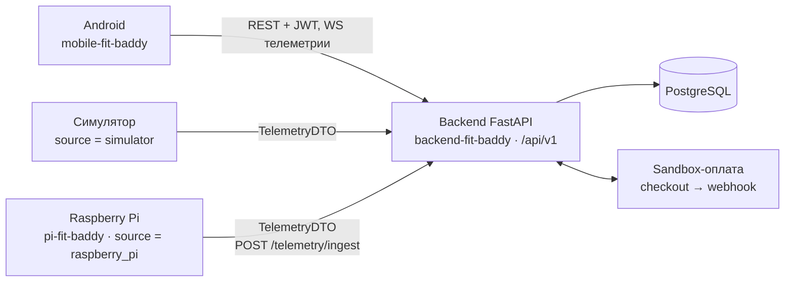
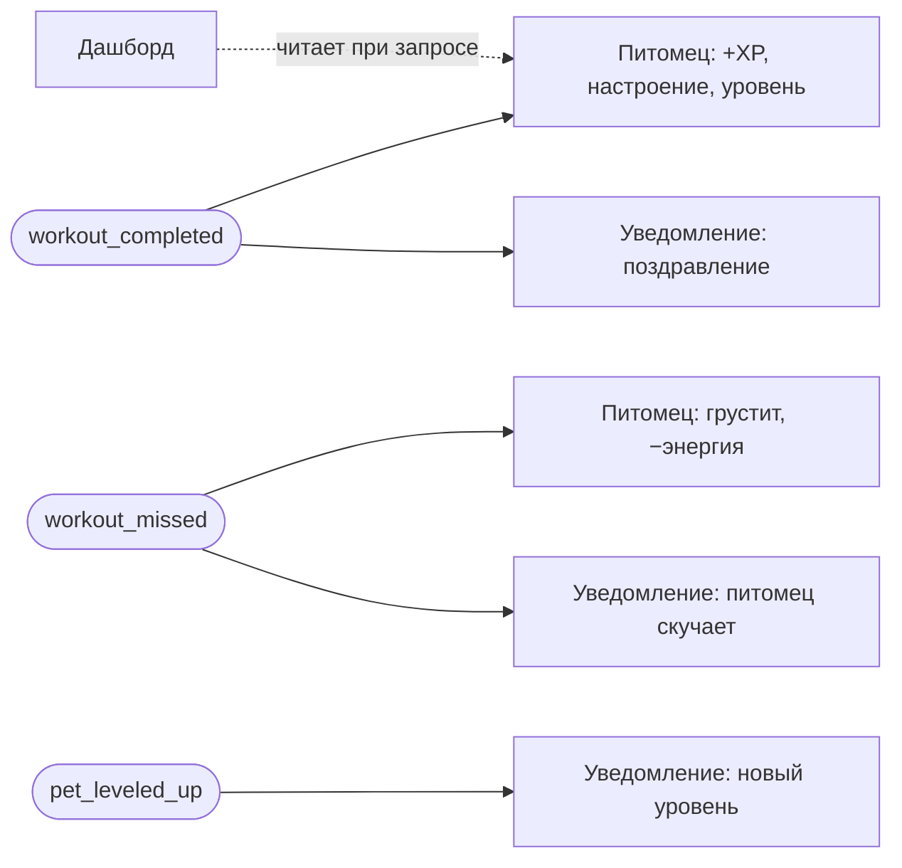

# FitQuest — фитнес-трекер с виртуальным питомцем 🦊

Учебный командный проект по дисциплине «Технология командной разработки программ».

**Репозиторий:** <https://github.com/SonyAkb/FitnessApp>

## Содержание

- [Описание проекта](#описание-проекта)
- [Назначение](#назначение)
- [Функционал](#функционал)
- [Структура репозитория](#структура-репозитория)
- [Быстрый старт](#быстрый-старт)
- [Архитектура](#архитектура)
- [Команда](#команда)
- [Пользователи и их проблемы](#пользователи-и-их-проблемы)
- [Пользовательские истории](#пользовательские-истории)
- [Документация](#документация)
- [Состояние проекта](#состояние-проекта)
- [Стек](#стек)

---

## Описание проекта

**FitQuest** — мобильное приложение для планирования тренировок и отслеживания прогресса, в котором результаты пользователя «прокачивают» виртуального питомца. Пользователь тренируется в реальной жизни, приложение фиксирует тренировки, а питомец растёт и радуется при регулярных занятиях и грустит при пропусках.

Система состоит из Android-приложения, сервера на FastAPI с базой PostgreSQL и узла на Raspberry Pi с датчиками пульса и шагов. Узел можно запускать и без платы — в режиме эмуляции датчиков.

## Назначение

Продукт помогает людям, которым трудно начать заниматься или удержать привычку: новичкам, которым нужен готовый план, регулярно тренирующимся, которым нужен контроль прогресса без ручного дневника, и тем, кто часто бросает тренировки. Эмоциональная связь с питомцем, квесты и мягкие напоминания возвращают пользователя к тренировкам, а автоматический сбор пульса и шагов и ИИ-подсказки снимают рутину.

## Функционал

- регистрация, профиль с целью, весом и уровнем подготовки;
- программы тренировок и расписание;
- экран выполнения тренировки: таймер отдыха, чек-лист подходов, история;
- виртуальный питомец: опыт, уровни, энергия, настроение, серия дней, квесты и достижения;
- дашборд прогресса и календарь активности;
- уведомления: напоминания и сообщения от питомца;
- подписка Free / Pro через тестовый (sandbox) платёжный провайдер;
- ИИ-рекомендация следующей тренировки (модель обучается в Google Colab);
- пульс и шаги: в тестовом режиме — симулятор, в боевом — Raspberry Pi с датчиками MPU6050 и MAX30102.

Что из этого уже работает, а что в плане, — в разделе [Состояние проекта](#состояние-проекта).

## Структура репозитория

```
backend-fit-baddy/    FastAPI + PostgreSQL: REST /api/v1, WebSocket, 8 модулей, тесты
mobile-fit-baddy/     Android-приложение (Java), основной клиент
pi-fit-baddy/         Raspberry Pi: эмуляция I2C, драйверы датчиков, /device/*, публикатор (в работе)
Animation_1/          кадры анимации питомца
docs/                 архитектура, API, БД, требования, планирование, тестирование
  requirements/       пользовательские истории, критерии приёмки, MoSCoW
  planning/           трассировка требований, решения, roadmap, задачи
  labs/               соответствие заданиям лабораторных
требования по лабам/  задания лабораторных работ
docker-compose.yml    db + backend
```

Каждая из папок `backend-fit-baddy`, `mobile-fit-baddy`, `pi-fit-baddy` самодостаточна: свой README, зависимости, тесты и CI-job.

## Быстрый старт

```bash
cp .env.example .env
docker compose up --build          # PostgreSQL + backend на http://localhost:8000 (Swagger: /docs)
```

Android: открыть `mobile-fit-baddy/` в Android Studio и запустить на эмуляторе (backend доступен по `http://10.0.2.2:8000`).
Подробно, включая запуск узла Raspberry Pi без платы, — [`docs/RUN.md`](docs/RUN.md).

## Архитектура

Модульный монолит: один backend, разделённый на независимые бизнес-модули, которые общаются через события внутри процесса. Подробно — [`docs/ARCHITECTURE.md`](docs/ARCHITECTURE.md), схема БД — [`docs/DATABASE.md`](docs/DATABASE.md), контракт — [`docs/API_CONTRACT.md`](docs/API_CONTRACT.md).



Приложение не знает, откуда пришли пульс и шаги: симулятор и Raspberry Pi отдают один и тот же `TelemetryDTO`, отличается только поле `source`.



### Модули

| # | Модуль | Что делает |
|---|---|---|
| 1 | Аккаунт и расписание | регистрация, JWT, профиль и цели, календарь, повторяющиеся тренировки |
| 2 | Тренировки | упражнения, программы, выполнение (подходы, повторы, вес, таймер), история; публикует `workout_completed` |
| 3 | Питомец и геймификация | XP, уровни, энергия, настроение, серия, квесты, достижения |
| 4 | Дашборд и уведомления | недельная статистика, графики, календарь активности, центр уведомлений, напоминания |
| 5 | ИИ, устройства, подписка | рекомендации, телеметрия (симулятор и Raspberry Pi), тарифы Free/Pro, sandbox-оплата |

## Команда

Работа разделена по бизнес-модулям (5 человек). Каждый участник — разработчик своего модуля целиком (backend, экраны Android, тесты).

| № | Участник (GitHub) | Основная роль | Дополнительная роль | Модуль и обязанности |
|---|---|---|---|---|
| 1 | [@NastyaZhilinaRis2](https://github.com/NastyaZhilinaRis2) | Разработчик | TODO(уточнить) | Модуль 1: регистрация, JWT, профиль, расписание и перенос тренировок |
| 2 | [@Hupubu](https://github.com/Hupubu) | Разработчик | TODO(уточнить) | Модуль 2: программы, каталог упражнений, экран выполнения, история тренировок |
| 3 | [@SonyAkb](https://github.com/SonyAkb) | Разработчик | TODO(уточнить) | Модуль 3: питомец, XP и уровни, настроение, квесты и достижения |
| 4 | [@Ananasic07](https://github.com/Ananasic07) | Разработчик | TODO(уточнить) | Модуль 4: дашборд, статистика, календарь активности, уведомления |
| 5 | [@MouseViolin](https://github.com/MouseViolin) | Разработчик | TODO(уточнить) | Модуль 5: ИИ-рекомендации, телеметрия и Raspberry Pi, подписка; помогает с Android |

## Пользователи и их проблемы

#### 1. Новичок — «Хочу начать, но не знаю, с чего»

**Кто это:** человек, который решил заняться спортом, но до этого не имел опыта тренировок. Те, кто давно откладывает «с понедельника», а теперь наконец собрались.

**Описание:** хочет прийти в форму, но его пугает сложность: непонятно, какие упражнения делать, сколько подходов, как долго отдыхать и как не бросить через неделю. Любая ошибка воспринимается как повод всё бросить.

**Главная проблема:** страх «сделать что-то не так», отсутствие готового плана и слабая мотивация на начальных этапах, когда результат ещё не виден.

**Как решает FitQuest:**
- **ИИ-рекомендации** снимают с пользователя необходимость составлять программу тренировок: приложение само подсказывает, что делать сегодня, исходя из его уровня и целей.
- **Экран выполнения тренировки** даёт чёткую структуру — таймер отдыха, чек-лист упражнений, фиксация факта выполнения. Не нужно думать, нужно просто идти по списку.
- **Виртуальный питомец и квесты** дают быстрый эмоциональный отклик: первые маленькие достижения («сделай 3 тренировки подряд») и радость персонажа закрепляют привычку ещё до того, как появятся видимые результаты в теле.

---

#### 2. Регулярный — «Занимаюсь постоянно, хочу контроля и удобства»

**Кто это:** опытный пользователь, у которого тренировки уже стали частью жизни (3–4 раза в неделю). Он знает, что делает, и ему не нужны базовые советы.

**Описание:** важны контроль, прогресс и удобство. Он ценит своё время и не хочет вручную вбивать кучу данных после каждой тренировки.

**Главная проблема:** рутина при ведении дневника тренировок, необходимость отслеживать прогрессию нагрузок (веса, повторения, объёмы) и желание видеть единую картину активности — не только в зале, но и в повседневной жизни.

**Как решает FitQuest:**
- **Автоматический сбор данных** (пульс, шаги) через единый API — пользователю не нужно вручную заполнять дневник активности, всё подтягивается само.
- **Дашборды и аналитика** дают наглядные графики прогресса по весам и календарь активности, чтобы видеть общую картину.
- **Pro-подписка** открывает расширенную аналитику и продвинутые ИИ-рекомендации для тех, кто хочет выйти на новый уровень.

---

#### 3. Непостоянный — «Начинаю, срываюсь, бросаю»

**Кто это:** человек с сильной начальной мотивацией, но слабой дисциплиной. Может отзаниматься месяц, потом забить на два, а затем снова начать — и так по кругу.

**Описание:** искренне хочет заниматься, но жизнь регулярно сбивает с пути. А когда он срывается, не находит сил/мотивации опять начать 

**Главная проблема:** Отсутствие внешней ответственности и эмоциональное выгорание. Обычные трекеры просто показывают «сломанную серию дней», что только усиливает демотивацию.

**Как решает FitQuest:**
- **Виртуальный питомец** — ключевая механика именно для этой аудитории. Персонаж «грустит» при пропусках, и пользователю психологически проще почувствовать ответственность *перед кем-то*, чем перед самим собой. Это мягко возвращает его к тренировкам.
- **Мотивационные уведомления** с откликом персонажа («Я скучаю, давай просто сделаем лёгкую разминку?») помогают вернуться в строй без давления.
- **Гибкость ИИ-рекомендаций**: если приложение видит, что пользователь давно не занимался, оно предложит более лёгкую тренировку, чтобы помочь мягко, а не резко, вернуться в режим.


## Пользовательские истории

Критерии приёмки каждой истории — [`docs/requirements/PRODUCT_USER_STORIES.md`](docs/requirements/PRODUCT_USER_STORIES.md); проверяемые критерии API — [`docs/requirements/ACCEPTANCE_CRITERIA.md`](docs/requirements/ACCEPTANCE_CRITERIA.md); приоритеты и границы MVP — [`docs/requirements/MOSCOW.md`](docs/requirements/MOSCOW.md).

| ID | Эпик | История | Формулировка | Персона |
|---|---|---|---|---|
| US-A1 | Знакомство | Регистрация и вход | Как новый пользователь, я хочу зарегистрироваться и войти в аккаунт, чтобы мои тренировки и прогресс сохранялись между устройствами. | Новичок |
| US-A2 | Знакомство | Заполнение профиля | Как пользователь, я хочу указать свои цели, текущий вес и уровень подготовки, чтобы приложение могло подбирать подходящие нагрузки. | Новичок |
| US-B1 | Мой план | Создание программы тренировок | Как пользователь, я хочу собрать программу из упражнений (с подходами, повторами, весом), чтобы заниматься по своему плану. | Регулярный, Новичок, Непостоянный |
| US-B2 | Мой план | Расписание тренировок | Как пользователь, я хочу расставить тренировки по календарю и настроить повторения, чтобы не держать план в голове. | Регулярный, Новичок, Непостоянный |
| US-B3 | Мой план | Перенос тренировки | Как пользователь, я хочу перенести запланированную тренировку на другой день, если планы изменились, чтобы не ломать расписание. | Непостоянный |
| US-C1 | На тренировке | Экран выполнения | Как пользователь, я хочу видеть во время тренировки таймер отдыха и чек-лист упражнений, чтобы не отвлекаться и не считать повторения в уме. | Регулярный, Новичок, Непостоянный |
| US-C2 | На тренировке | Фиксация выполнения | Как пользователь, я хочу отмечать выполненные подходы и завершать тренировку, чтобы история была актуальной. | Регулярный |
| US-C3 | На тренировке | История тренировок | Как пользователь, я хочу просматривать список прошлых тренировок, чтобы видеть, что и когда я делал. | Регулярный, Новичок, Непостоянный |
| US-D1 | Мой питомец | Рост питомца | Как пользователь, я хочу , чтобы мой питомец рос и радовался после выполненных тренировок, чтобы мне было приятно возвращаться в приложение. | Непостоянный |
| US-D2 | Мой питомец | Реакция на пропуски | Как пользователь, я хочу видеть, что питомец «грустит» при пропусках, чтобы мягко мотивировать себя не забрасывать тренировки. | Непостоянный |
| US-D3 | Мой питомец | Квесты и достижения | Как пользователь, я хочу выполнять квесты («3 тренировки подряд»), чтобы получать очки для питомца и чувствовать прогресс. | Новичок, Непостоянный |
| US-E1 | Мои результаты | Дашборд прогресса | Как пользователь, я хочу видеть графики прогресса по весам и повторениям, чтобы понимать, расту ли я. | Регулярный, Непостоянный |
| US-E2 | Мои результаты | Календарь активности | Как пользователь, я хочу видеть календарь с отметками тренировочных дней, чтобы оценивать свою регулярность. | Регулярный, Новичок, Непостоянный |
| US-F1 | Поддержка | Напоминания о тренировке | Как пользователь, я хочу получать пуш-уведомления о запланированной тренировке, чтобы не забывать о ней. | Непостоянный |
| US-F2 | Поддержка | Мотивационные уведомления от питомца | Как пользователь, я хочу получать сообщения от персонажа («Я скучаю; А ну ка быстро на тренировку, человек»), чтобы возвращаться в приложение даже после долгого перерыва. | Непостоянный |
| US-G1 | Подписка | Просмотр тарифов | Как пользователь, я хочу видеть, какие функции доступны на free и pro, чтобы решить, нужна ли мне подписка. | Регулярный, Новичок, Непостоянный |
| US-G2 | Подписка | Оформление подписки | Как пользователь, я хочу оформить подписку через встроенную платёжную систему, чтобы получить доступ к pro-функциям. | Регулярный |
| US-H1 | Умные функции | Авто-сбор активности | Как пользователь, я хочу, чтобы шаги и пульс автоматически подтягивались в приложение, чтобы не вводить их вручную. | Регулярный |
| US-H2 | Умные функции | ИИ-рекомендация следующей тренировки | Как пользователь, я хочу получать рекомендацию, какую тренировку сделать следующей, чтобы не подбирать программу самому. | Новичок |

## Документация

| Документ | О чём |
|---|---|
| [docs/ARCHITECTURE.md](docs/ARCHITECTURE.md) | **архитектура проекта**: обоснование, UML-схема компонентов, модули, интерфейсы, технологии, потоки данных |
| [docs/DATABASE.md](docs/DATABASE.md) | схема БД (ER-диаграммы) |
| [docs/API_CONTRACT.md](docs/API_CONTRACT.md) | контракт REST/WS API |
| [docs/RUN.md](docs/RUN.md) | запуск всех частей |
| [docs/TESTING.md](docs/TESTING.md) | стратегия тестирования и CI |
| [docs/requirements/REQUIREMENTS.md](docs/requirements/REQUIREMENTS.md) | **требования к проекту**: пользователи, FR/NFR, ключевые истории, границы MVP |
| [docs/requirements/](docs/requirements/README.md) | истории, критерии приёмки, MoSCoW |
| [docs/pi.md](docs/pi.md) | требования к узлу Raspberry Pi |
| [docs/planning/](docs/planning/) | трассировка требований, решения, roadmap, задачи |
| [docs/labs/LAB_COMPLIANCE.md](docs/labs/LAB_COMPLIANCE.md) | что требовали лабораторные и где это сделано |

## Состояние проекта

На 14.10.2026 (подробно — [`docs/planning/REQUIREMENTS_TRACE.md`](docs/planning/REQUIREMENTS_TRACE.md)):

- ✅ сквозной сценарий «вход → тренировка → XP питомцу → дашборд → уведомление → пульс и шаги симулятора» работает в API и в Android;
- 🟡 экраны выполнения тренировки (таймер отдыха, чек-лист), расписания, квестов, тарифов и графиков — в работе;
- 🟡 узел Raspberry Pi `pi-fit-baddy` — в работе;
- план работ по спринтам — [`docs/planning/ROADMAP.md`](docs/planning/ROADMAP.md).

## Стек

| Часть | Технологии |
|---|---|
| Backend | Python 3.11, FastAPI, SQLAlchemy 2, Pydantic 2, PostgreSQL 16, pytest |
| Android | Java 17, Android SDK 34 (min 26), Retrofit, OkHttp WebSocket |
| Raspberry Pi | Python 3.11, FastAPI, smbus2, gpiozero; эмуляция — FakeSMBus и виртуальные чипы |
| ИИ | правила на сервере; модель обучается в Google Colab |
| Инфраструктура | Docker Compose, GitHub Actions |
