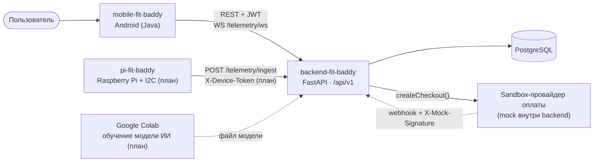
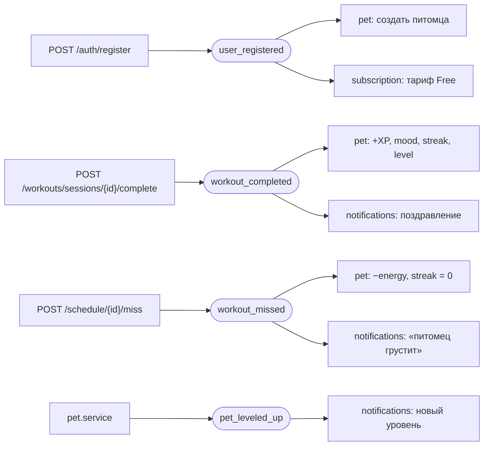
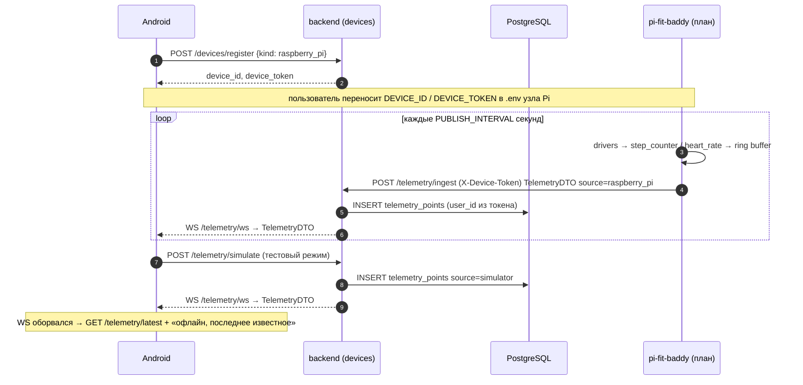
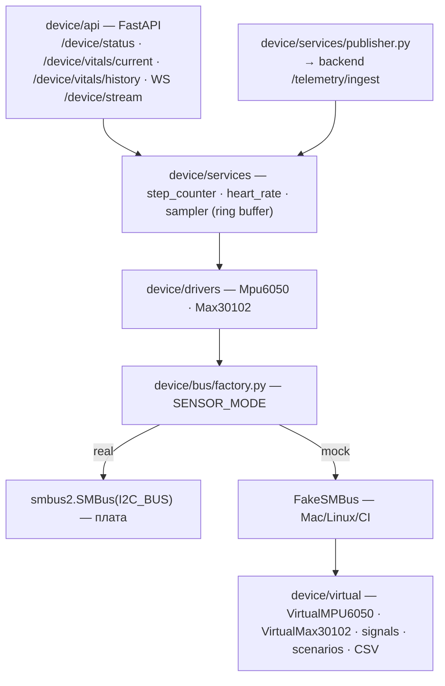
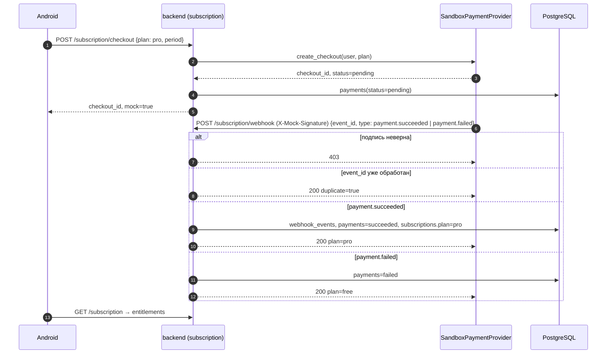
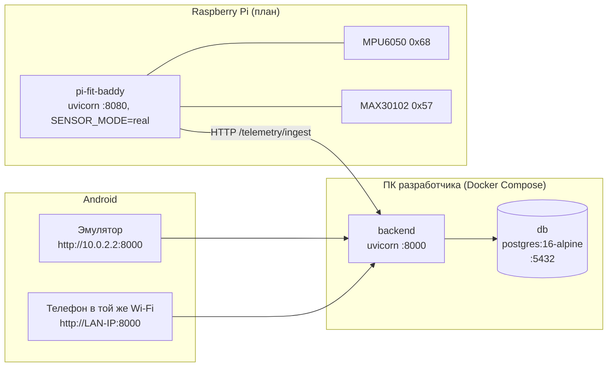
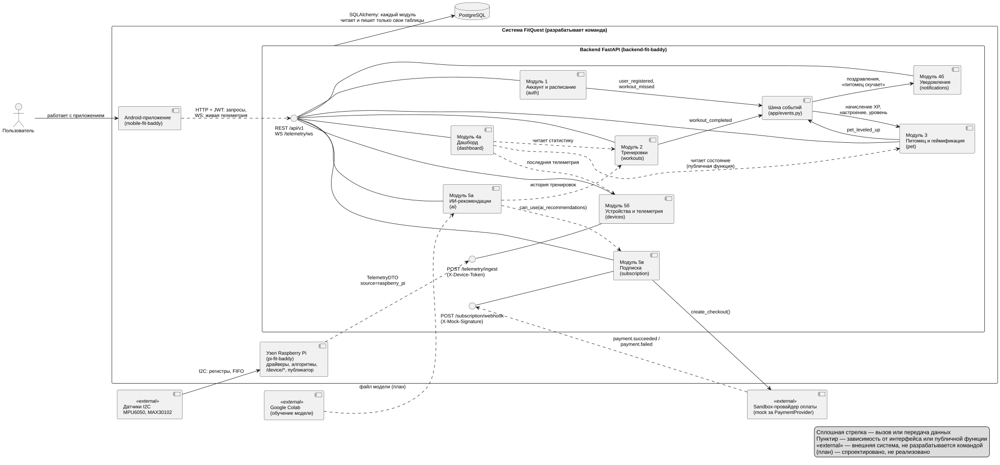

# Архитектура FitQuest

> **Единый источник правды** по архитектуре. Корневой `README.md` и README папок повторяют отсюда только обзор и ссылаются сюда.
> Схема БД — [`DATABASE.md`](DATABASE.md), контракт API — [`API_CONTRACT.md`](API_CONTRACT.md), решения — [`planning/DECISIONS.md`](planning/DECISIONS.md).
> Пометка **(план)** — спроектировано, но ещё не реализовано; ссылка на задачу — в `docs/planning/issues/`.

UML-диаграмма компонентов: [`architecture/fitquest-components.svg`](architecture/fitquest-components.svg) (исходник PlantUML — [`architecture/fitquest-components.puml`](architecture/fitquest-components.puml)); пояснения — раздел 12.

Учебный MVP: **модульный монолит** (FastAPI + PostgreSQL), нативный **Android**-клиент и узел **Raspberry Pi** с датчиками. Без микросервисов и брокеров сообщений.

## 1. Части системы и папки

| Папка | Что это | Технологии | Статус |
|---|---|---|---|
| `backend-fit-baddy/` | Сервер-мост: REST `/api/v1`, WebSocket телеметрии, PostgreSQL, in-process события, 8 бизнес-модулей | Python 3.11, FastAPI, SQLAlchemy 2, Pydantic 2 | MVP работает |
| `mobile-fit-baddy/` | Основной клиент | Android, Java 17, Retrofit, OkHttp WS | MVP работает |
| `pi-fit-baddy/` | Узел датчиков: MPU6050 (шаги) + MAX30102 (пульс) по I2C, эмуляция на уровне регистров, локальный API `/device/*`, публикатор в backend | Python 3.11, FastAPI, smbus2/gpiozero (только на плате) | **(план)** — требования в [`pi.md`](pi.md) |
| `docs/` | Требования, архитектура, планирование | Markdown + Mermaid | |
| `Animation_1/` | Кадры анимации питомца | PNG | используется Android |

Ранний черновик `backend/` + `frontend/` (React) и `tmp/` из основной ветки удаляются и хранятся под тегом `archive/react-draft` (решение D-01).

Каждая из трёх кодовых папок **самодостаточна**: свой README, свои зависимости, свои тесты, свой job в CI, без импортов друг из друга.

## 2. Контекст



Ключевые принципы:

1. **Клиент не знает источник телеметрии.** Симулятор и Pi отдают один `TelemetryDTO`, отличается только `source` (`simulator` | `raspberry_pi`).
2. **Android ходит только в backend.** Локальный API Pi `/device/*` — для отладки и публикатора, не для телефона (решение D-17).
3. **Игровые правила — только на сервере**, в модуле `pet`. Клиент отображает состояние.
4. **Модули общаются через события и публичные функции сервисов**, а не через чужие модели.
5. **Оплата — sandbox** за абстракцией `PaymentProvider`; реальный провайдер — вне MVP.

## 3. Модули и владельцы

Разделение по бизнес-модулям (5 человек).

| # | Модуль | Папка backend | Таблицы | Эндпоинты | Экраны Android | Владелец |
|---|---|---|---|---|---|---|
| 1 | Аккаунт и расписание | `auth` | users, profiles, scheduled_workouts | `/auth/*`, `/profile`, `/schedule/*` | Splash, Auth, Pack (профиль), расписание (план) | [@NastyaZhilinaRis2](https://github.com/NastyaZhilinaRis2) |
| 2 | Тренировки | `workouts` | workout_plans, workout_plan_exercises, workout_sessions (+ exercises, exercise_sets — план) | `/workouts/*` | Quest (планы, сессия, история) | [@Hupubu](https://github.com/Hupubu) |
| 3 | Питомец и геймификация | `pet` | pets (+ quests, user_quests, achievements, user_achievements; pet_events — план) | `/pet` (+ `/pet`, `/pet/quests`, `/pet/achievements`) | Den (питомец) | [@SonyAkb](https://github.com/SonyAkb) |
| 4 | Дашборд и уведомления | `dashboard`, `notifications` | notifications | `/dashboard/summary`, `/notifications/*` | Trail (прогресс), Calls (уведомления) | [@Ananasic07](https://github.com/Ananasic07) |
| 5 | ИИ, устройства, подписка | `ai`, `devices`, `subscription` | ai_recommendations, devices, telemetry_points, subscriptions, payments, webhook_events | `/ai/*`, `/devices/*`, `/telemetry/*`, `/subscription/*` | Live watch, рекомендация на Trail, тариф на Pack | [@MouseViolin](https://github.com/MouseViolin) |
| — | Узел Raspberry Pi | `pi-fit-baddy/` (отдельно) | — (кольцевой буфер в памяти) | `/device/*` | — | [@MouseViolin](https://github.com/MouseViolin) |

## 4. Слои backend

```
HTTP / WS router      — разбор запроса, зависимость get_current_user, коды ответа
    → Pydantic schemas — контракт (вход/выход)
    → service          — бизнес-логика модуля, публикация событий
    → (repository)     — запросы к БД; сейчас внутри service, выделяется по мере роста
    → SQLAlchemy models → PostgreSQL
```

Роутер не содержит бизнес-логики. Общий код — `app/core/` (конфиг, БД, JWT, часы, зависимости) и `app/events.py` (шина событий).

## 5. Границы модулей

**Разрешено:**
- публиковать и слушать события через `app.events.event_bus`;
- вызывать **публичные read-функции** чужого `service.py` из списка ниже (решение D-06);
- использовать `app.core.deps.get_current_user` (возвращает `User` из модуля `auth`).

**Запрещено:** импортировать чужие `models.py`, писать в чужие таблицы, дублировать чужие правила (например, считать XP вне `pet`).

| Потребитель | Чужая публичная функция | Зачем |
|---|---|---|
| `dashboard` | `pet.service.get_or_create_pet`, `workouts.service.count_completed/count_all`, `auth.service.list_today_schedule/count_missed`, `devices.service.get_latest` | сводка |
| `ai` | `workouts.service.count_completed` (план: `workouts.service.history_summary`) | признаки для рекомендации |
| `ai` | `subscription.service.can_use(db, user_id, "ai_recommendations")` | проверка тарифа |
| `auth` (schedule) | `workouts.service.get_plan` | проверка `plan_id` у слота |
| `workouts` | `subscription.service.can_use(db, user_id, "plans_unlimited")` **(план)** | лимит Free: 2 программы |

## 6. События

Шина — в процессе FastAPI (`app/events.py`): `publish(name, payload, db)` синхронно вызывает подписчиков в той же транзакции. Kafka/RabbitMQ не используются.



| Событие | Публикует | Payload | Подписчики |
|---|---|---|---|
| `user_registered` | auth | `user_id` | pet, subscription |
| `workout_completed` | workouts | `user_id, session_id, completed_at, duration_seconds` | pet, notifications |
| `workout_missed` | auth (schedule) | `user_id, scheduled_id, title, missed_at` | pet, notifications |
| `pet_leveled_up` | pet | `user_id, level, name` | notifications |
|`quest_completed`, `achievement_earned` | pet | `user_id, code, title, xp_reward` | notifications |
| `subscription_changed` **(план)** | subscription | `user_id, plan, status` | notifications |
| `telemetry_received` **(план)** | devices | `TelemetryDTO` | WS-рассылка |

Dashboard событий не слушает: он читает актуальные данные при запросе и не хранит копий.

## 7. Телеметрия: симулятор и Raspberry Pi



Сейчас реализовано: регистрация устройства, `simulate`, `latest`, `history`, WS. **WS пока сам генерирует синтетику** раз в `TELEMETRY_WS_INTERVAL_SECONDS`; по решению D-17 он переводится на рассылку сохранённых точек (иначе данные Pi в WS не попадут). `POST /telemetry/ingest` — (план).

`TelemetryDTO`: `device_id, user_id, steps, heart_rate, calories, timestamp, source`. Для Pi `calories` считает публикатор по шагам (D-18), `user_id` определяет backend по токену.

### Узел Pi изнутри (план, по `docs/pi.md`)



Единственная точка ветвления mock/real — `bus/factory.py`. Драйверы и сервисы одинаковы в обоих режимах.

## 8. Подписка: checkout → webhook



Доступ проверяется одной функцией `subscription.service.can_use(db, user_id, feature)`: Free — `workouts` (до 2 программ), `pet`, `dashboard`; Pro — плюс `ai_recommendations`, `plans_unlimited`.

Реализовано: `PaymentProvider` + `SandboxPaymentProvider` (`subscription/providers.py`) — sandbox подтверждает оплату сразу; webhook проверяет `X-Mock-Signature`, идемпотентен по `event_id`, обрабатывает `payment.failed`; `can_use` закрывает ИИ на Free. Лимит «2 программы на Free» — (план).

## 9. Развёртывание



- Стандартный запуск: `docker compose up --build` (сервисы `db`, `backend`). Подробно — [`RUN.md`](RUN.md).
- Pi без платы запускается на любой машине в `SENSOR_MODE=mock`.
- CI (GitHub Actions) — отдельный job на каждую папку (`docs/TESTING.md`).

## 10. Клиент Android

- Экраны: Splash, Auth, нижняя навигация Den / Quest / Trail / Calls / Pack, Live watch. Соответствие экранов и методов API — `mobile-fit-baddy/SCREENS.md`.
- JWT в EncryptedSharedPreferences; 401 → выход на экран входа.
- Таймер тренировки — локальный, на сервер уходит один `POST .../complete`.
- Телеметрия: WS, при обрыве — опрос `GET /telemetry/latest` и статус «офлайн».

## 11. Вне архитектуры MVP

Kubernetes, очереди сообщений, CQRS, микросервисы; реальный платёжный провайдер; FCM-push; веб-клиент; интеграции Apple Health/Google Fit. Список функций вне MVP — решение D-16.

## 12. Архитектура проекта: обоснование и описание (лабораторная №3)

### 12.1. Тип архитектуры и почему он выбран

FitQuest построен из трёх отдельных приложений, которые общаются по сети, и одного **модульного монолита** внутри сервера:

| Часть | Подход | Где что находится |
|---|---|---|
| Android ↔ backend | **клиент-сервер**: тонкий клиент, все правила на сервере | интерфейс пользователя и локальный таймер — в Android; правила, обработка и хранение — в backend |
| backend | **модульный монолит** со **слоями** внутри модуля (router → schemas → service → models) | один процесс FastAPI, 8 модулей с собственными таблицами; общаются через шину событий в том же процессе и публичные функции сервисов |
| Raspberry Pi → backend | **отдельное устройство-источник данных** (издатель) | драйверы, алгоритмы и локальный API на плате; в backend уходит готовая точка `TelemetryDTO` |
| backend ↔ платёжный провайдер, Colab | **внешние системы** за интерфейсами | `PaymentProvider` (сейчас sandbox), файл модели ИИ |

Почему так:

- **Пять человек работают параллельно.** У каждого — свой модуль со своими таблицами и роутером; пересечения сведены к событиям и списку разрешённых вызовов (раздел 5). Это даёт независимость микросервисов без их затрат на сеть, деплой и согласованность данных.
- **Сроки:** MVP к началу декабря 2026, проект до 25.12.2026. Один процесс, одна БД и `docker compose up` — минимум инфраструктуры, которую команда успеет поднять и показать.
- **Опыт команды:** Python и FastAPI для сервера, Java для Android — языки из учебной программы.
- **Три папки независимы** и общаются только по HTTP: каждую можно собрать, протестировать и показать отдельно.

Компромиссы:

- модули живут в одном процессе — ошибка в одном может уронить весь сервер; масштабировать модули по отдельности нельзя (для учебного проекта не нужно);
- события синхронные, в той же транзакции — проще отлаживать, но медленный обработчик замедляет запрос;
- дашборд читает чужие данные через публичные функции, а не через свою копию — нет рассинхронизации, но есть связность модулей;
- Pi пушит данные сам — нужен токен устройства и буферизация на плате при обрыве сети.

**В MVP (к декабрю):** Android, backend со всеми 8 модулями, симулятор телеметрии, sandbox-оплата, ИИ на правилах. **Дальнейшее развитие:** узел Pi на реальной плате, модель из Colab, Alembic-миграции, реальный платёжный провайдер.

### 12.2. Схема



Нотация — UML, диаграмма компонентов. Исходник: [`architecture/fitquest-components.puml`](architecture/fitquest-components.puml) (PlantUML, редактируется как текст; как открыть — [`architecture/README.md`](architecture/README.md)). Сплошная стрелка — вызов или передача данных; пунктир — зависимость от интерфейса или публичной функции; `«external»` — внешняя система.

### 12.3. Модули и их функции

| Модуль | Назначение и основные функции | Границы ответственности | Данные | Взаимодействие |
|---|---|---|---|---|
| **Android-приложение** | Экраны входа, питомца, тренировки, прогресса, уведомлений, профиля и телеметрии; локальный таймер тренировки; хранение токена | Не считает XP, уровни и статистику — только показывает то, что вернул сервер | JWT, активная сессия, адрес сервера | Вызывает REST API backend, получает живую телеметрию по WebSocket |
| **1. Аккаунт и расписание** (`auth`) | Регистрация и вход, JWT, профиль с целью, весом и уровнем; расписание, перенос и пропуск тренировок | Не хранит тренировки и питомца; проверяет только существование плана у слота | users, profiles, scheduled_workouts | Публикует `user_registered`, `workout_missed`; обращается к `workouts` за проверкой плана |
| **2. Тренировки** (`workouts`) | Программы из упражнений с подходами, повторами и весом; начало и завершение сессии; история | Не начисляет XP и не создаёт уведомления — только сообщает о завершении | workout_plans, workout_plan_exercises, workout_sessions (+ exercises, exercise_sets — план) | Публикует `workout_completed`; отдаёт статистику дашборду и ИИ |
| **3. Питомец и геймификация** (`pet`) | XP, уровни, энергия, настроение, серия дней; квесты и достижения (план) | Единственное место игровых правил | pets (+ pet_events, quests, achievements — план) | Слушает `user_registered`, `workout_completed`, `workout_missed`; публикует `pet_leveled_up`, `quest_completed`, `achievement_earned` |
| **4а. Дашборд** (`dashboard`) | Сводка за неделю: тренировки, пропуски, серия, XP, шаги, тренировки по дням | Не хранит своих данных — агрегирует при запросе | — | Читает публичные функции `pet`, `workouts`, `auth`, `devices` |
| **4б. Уведомления** (`notifications`) | Центр уведомлений: поздравления, «питомец скучает», новый уровень; отметка прочитанного | Не решает, когда питомец грустит — реагирует на события | notifications | Слушает `workout_completed`, `workout_missed`, `pet_leveled_up` |
| **5а. ИИ-рекомендации** (`ai`) | Рекомендация следующей тренировки с обоснованием и предупреждением «не медицинский совет»; история | Не меняет тренировки и расписание — только советует | ai_recommendations | Читает историю у `workouts`, проверяет тариф у `subscription` |
| **5б. Устройства и телеметрия** (`devices`) | Регистрация устройств, приём точек (симулятор, Pi), последняя точка, история, WebSocket | Не знает, как устройство измеряет данные; не связан с тренировками | devices, telemetry_points | Принимает данные от Pi (`/telemetry/ingest`, план) и симулятора; отдаёт Android и дашборду |
| **5в. Подписка** (`subscription`) | Тарифы Free/Pro, checkout через sandbox-провайдер, идемпотентный webhook, история платежей, проверка доступа `can_use` | Не реализует функции Pro — только разрешает или запрещает | subscriptions, payments, webhook_events | Вызывает провайдера; принимает webhook; отвечает другим модулям на `can_use` |
| **Шина событий** (`app/events.py`) | Доставка событий подписчикам в том же процессе | Не хранит события | — | Связывает публикующие и слушающие модули |
| **Узел Raspberry Pi** (`pi-fit-baddy`) | Чтение MPU6050 и MAX30102 (или их эмуляции), подсчёт шагов и пульса, локальный API, публикация в backend | Не знает о пользователях и игре; `user_id` определяет backend | кольцевой буфер последних измерений | Датчики по I2C → backend по HTTP с токеном устройства |

Функции сгруппированы по бизнес-смыслу, а не по слоям: всё про одну сущность (тренировка, питомец, подписка) и её правила — в одном модуле с одним владельцем. Дашборд и уведомления разделены, потому что первый читает данные, а второй реагирует на события.

### 12.4. Связи и интерфейсы

| Откуда → куда | Зачем | Способ | Что передаётся и что происходит |
|---|---|---|---|
| Android → backend | Все действия пользователя | HTTP REST + JWT | Приложение отправляет действие (войти, создать план, завершить тренировку); сервер проверяет права и данные, сохраняет результат и возвращает новое состояние, которое экран показывает |
| backend → Android | Живые пульс и шаги | WebSocket | Сервер присылает каждую новую точку телеметрии; при обрыве приложение берёт последнюю точку по REST и показывает «офлайн» |
| Тренировки → шина → Питомец, Уведомления | Награда за тренировку | событие в процессе | После завершения тренировки модуль тренировок сообщает «тренировка завершена»; питомец начисляет XP и меняет настроение, центр уведомлений создаёт поздравление |
| Расписание → шина → Питомец, Уведомления | Реакция на пропуск | событие в процессе | Пропущенный слот уменьшает энергию питомца и создаёт уведомление «питомец скучает» |
| Питомец → шина → Уведомления | Новый уровень | событие в процессе | При переходе порога XP появляется уведомление о новом уровне |
| Дашборд → Питомец, Тренировки, Расписание, Устройства | Сводка прогресса | вызов публичной функции сервиса | Дашборд при запросе читает текущие XP, серию, число тренировок и пропусков, последние шаги — и собирает одну сводку |
| ИИ → Тренировки, Подписка | Рекомендация | вызов публичной функции | ИИ получает краткую историю тренировок и проверяет, разрешена ли функция на тарифе пользователя |
| Raspberry Pi → backend | Реальные пульс и шаги | HTTP с токеном устройства | Плата раз в несколько секунд отправляет точку; сервер по токену находит пользователя, сохраняет точку и рассылает её по WebSocket |
| Подписка → провайдер → Подписка | Оплата Pro | вызов + webhook с подписью | Сервер создаёт оплату у провайдера; провайдер присылает результат; сервер проверяет подпись и повтор, затем включает Pro или фиксирует отказ |
| Все модули → PostgreSQL | Хранение | SQLAlchemy | Каждый модуль читает и пишет только свои таблицы |

Подробные методы — в [`API_CONTRACT.md`](API_CONTRACT.md), последовательности — разделы 7–8.

### 12.5. Технологии и инструменты

| Технология | Где и для чего | Почему подходит | Ограничения |
|---|---|---|---|
| Python 3.11 | backend, узел Raspberry Pi | Один язык для сервера и платы: Pi официально поддерживает Python, библиотеки I2C (`smbus2`) — на Python; знаком команде | Медленнее компилируемых языков — для нагрузки учебного проекта не важно. На 3.13+ закреплённые зависимости не собираются |
| FastAPI + Pydantic 2 | REST и WebSocket backend и локальный API Pi | Схемы запросов и ответов из Pydantic, автоматический Swagger `/docs` для проверки без клиента, встроенный WebSocket | Синхронный доступ к БД внутри async-WS требует аккуратности |
| SQLAlchemy 2 | Модели и запросы к БД | Модели по модулям, одинаковый код для PostgreSQL и SQLite в тестах | Пока без Alembic — схема создаётся при старте; миграции нужно подключить |
| PostgreSQL 16 | Хранение пользователей, тренировок, питомцев, телеметрии, платежей | Реляционные связи между сущностями, транзакции для событий, уникальность для идемпотентности webhook; запускается в Docker одной командой | Нужен Docker (или локальная установка) для запуска |
| Шина событий в процессе | Связь модулей backend | Модули не импортируют друг друга, логика реакции — у потребителя; не нужен брокер сообщений | События не переживают перезапуск и не доставляются в другие процессы |
| Java 17 + Android SDK 34, Retrofit, OkHttp | Android-клиент | Нативное приложение на целевых устройствах команды; Java — язык из учебной программы; Retrofit и OkHttp — стандарт для REST и WebSocket | Нет iOS-клиента; UI пишется вручную на XML-разметке |
| smbus2, gpiozero | Доступ к I2C и GPIO на Raspberry Pi | Стандартные библиотеки платы; `gpiozero` имеет mock-фабрику пинов для тестов | Работают только на плате — импортируются лениво, в тестах заменяются эмуляцией |
| pytest | Тесты backend и Pi | Простые тесты, `TestClient` FastAPI для API без запуска сервера | — |
| Docker Compose | Запуск БД и backend | Одинаковый запуск на Mac и Windows без установки PostgreSQL и Python | Нужен Docker Desktop |
| GitHub Actions | CI: отдельный job на каждую папку | Рядом с репозиторием, бесплатно | Android-сборка в CI долгая — кэш Gradle |
| Google Colab | Обучение модели ИИ | Бесплатный GPU, не нужна локальная настройка | Модель переносится в backend файлом; инференс должен быть лёгким |

Рассматривались и отклонены: микросервисы (лишняя инфраструктура для 5 человек и 3 месяцев), React-клиент (основной клиент — Android, решение D-01), реальный платёжный провайдер (не нужен для демонстрации, требует юридических и тестовых аккаунтов).
