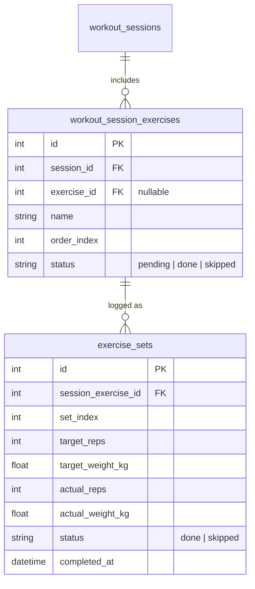

# Схема базы данных FitQuest

PostgreSQL 16 (в тестах — SQLite in-memory). Модели — SQLAlchemy 2.x в `backend-fit-baddy/app/modules/*/models.py`.
Схема управляется миграциями Alembic (`backend-fit-baddy/alembic/`, задача [CORE-04](planning/issues/subject-1/CORE-04.md)); см. раздел 4.

Каждая таблица принадлежит **одному** модулю. Чужой модуль не пишет в неё и не импортирует её модель (правило — `docs/ARCHITECTURE.md`, раздел «Границы модулей»).

## 1. Текущая схема (по коду на 27.10.2026)

```mermaid
erDiagram
  users ||--|| profiles : "has"
  users ||--o{ scheduled_workouts : "plans"
  users ||--o{ workout_plans : "owns"
  workout_plans ||--o{ workout_plan_exercises : "contains"
  exercises |o--o{ workout_plan_exercises : "picked from"
  users ||--o{ workout_sessions : "performs"
  workout_plans ||--o{ workout_sessions : "template of"
  scheduled_workouts |o--o{ workout_sessions : "started from"
  scheduled_workouts }o--o| workout_plans : "uses"
  users ||--|| pets : "has"
  users ||--o{ notifications : "receives"
  users ||--o{ devices : "registers"
  users ||--o{ telemetry_points : "produces"
  users ||--o{ ai_recommendations : "gets"
  users ||--|| subscriptions : "has"
  users ||--o{ payments : "pays"

  users {
    int id PK
    string email UK
    string hashed_password
    string display_name
    string role "user | admin"
    bool is_active
    datetime created_at
  }
  profiles {
    int id PK
    int user_id FK,UK
    string goal "nullable"
    float weight_kg "nullable"
    string fitness_level "nullable"
  }
  scheduled_workouts {
    int id PK
    int user_id FK
    string title
    datetime planned_at
    int workout_plan_id FK "nullable"
    string repeat_rule "nullable, не разворачивается"
    string status "planned | missed | completed"
    datetime ends_at
    datetime missed_at
    datetime created_at
  }
  workout_plans {
    int id PK
    int user_id FK
    string title
    string description
    datetime created_at
    datetime archived_at "nullable, NULL = план активен (мягкое удаление)"
  }
  exercises {
    int id PK
    string name UK
    string muscle_group "chest | back | legs | glutes | shoulders | biceps | triceps | core | full_body"
    string description "nullable"
  }
  workout_plan_exercises {
    int id PK
    int plan_id FK
    int exercise_id FK "nullable, ON DELETE SET NULL, ссылка на каталог"
    string name "свободный текст"
    int sets
    int reps
    float weight_kg
    int rest_seconds
    int order_index
  }
  workout_sessions {
    int id PK
    int user_id FK
    int workout_plan_id FK
    int scheduled_id FK "nullable"
    string status "in_progress | completed"
    datetime started_at
    datetime completed_at
    int duration_seconds
    int xp_awarded
  }
  pets {
    int id PK
    int user_id FK,UK
    string name
    int xp
    int level
    int energy "0..100"
    string mood "idle | happy | sad | level_up | neutral | sleeping"
    boolean was_sleeping "PET-06: питомец спал 14+ дней (приветствие при пробуждении)"
    int streak_days
    date last_activity_date
    datetime updated_at
  }
  users ||--o{ user_quests : "does"
  users ||--o{ user_achievements : "earns"
  quests ||--o{ user_quests : "assigned"
  achievements ||--o{ user_achievements : "earned"
    quests {
    int id PK
    string code UK "preset: one_workout_today | three_workouts_week"
    string title
    string period "daily | weekly"
    int target
    int xp_reward
  }
  user_quests {
    int id PK
    int user_id FK
    int quest_id FK
    int progresss
    datetime period_start
    datetime completed_at "nullable"
  }
  achievements {
    int id PK
    string code UK "preset: first_workout | three_in_row | week_no_miss"
    string title
    int xp_reward
  }
  user_achievements {
    int id PK
    int user_id FK
    int achievement_id FK
    datetime earned_at
  }

  pets ||--o{ pet_events : "logs"
  users ||--o{ pet_events : "has"
  pet_events {
    int id PK
    int pet_id FK
    int user_id FK
    string type "xp | level_up | mood | return_bonus"
    int amount "XP для xp/return_bonus; новый уровень для level_up"
    int xp_total "накопленный XP после события"
    int level "уровень после события"
    string mood "настроение после события, nullable"
    datetime created_at "индекс: статистика за неделю"
  }

  notifications {
    int id PK
    int user_id FK
    string title
    text body
    string kind "workout_completed | workout_missed | pet"
    bool is_read
    datetime created_at
  }
  devices {
    int id PK
    string device_id UK
    string device_token
    int user_id FK
    string name
    string kind "simulator | raspberry_pi"
    datetime created_at
  }
  telemetry_points {
    int id PK
    string device_id
    int user_id FK
    int steps
    int heart_rate
    int calories
    datetime timestamp
    string source "simulator | raspberry_pi"
  }
  ai_recommendations {
    int id PK
    int user_id FK
    text text
    datetime created_at
  }
  subscriptions {
    int id PK
    int user_id FK,UK
    string plan "free | pro"
    string status
    datetime updated_at
  }
  payments {
    int id PK
    int user_id FK
    int amount "в центах"
    string currency
    string status
    string provider "sandbox"
    datetime created_at
  }
  webhook_events {
    int id PK
    string event_id UK "идемпотентность"
    string event_type
    int user_id "без FK"
    datetime processed_at
  }
```

| Таблица | Модуль (папка) | Владелец |
|---|---|---|
| `users`, `profiles`, `scheduled_workouts` | `auth` | @NastyaZhilinaRis2 |
| `workout_plans`, `workout_plan_exercises`, `workout_sessions` | `workouts` | @Hupubu |
| `pets`, `pet_events`, `quests`, `user_quests`, `achievements`, `user_achievements` | `pet` | @SonyAkb |
| `notifications` | `notifications` | @Ananasic07 |
| `devices`, `telemetry_points` | `devices` | @MouseViolin |
| `ai_recommendations` | `ai` | @MouseViolin |
| `subscriptions`, `payments`, `webhook_events` | `subscription` | @MouseViolin |

## 2. Планируемые таблицы (нужны для закрытия требований)

Не реализованы. Каждая — отдельная задача в `docs/planning/issues/`.
(`pet_events` из этого списка реализована в PET-09, миграция 0005 — см. §1.)

Также планируется:
- `profiles.goal` / `profiles.fitness_level` — ограничить значениями (`weight_loss | muscle_gain | endurance | health`; `beginner | intermediate | advanced`, по умолчанию `beginner`).
- `pets.mood` — добавить `sleeping` (решение D-14). **Реализовано (PET-06, миграция 0004):** `sleeping` включён в домен, добавлен флаг `pets.was_sleeping`.
- `notification_settings` (user_id, reminders_enabled, reminder_offsets, motivational_enabled) — для US-F1/F2.
- `payments.status` — `pending | succeeded | failed`, `subscriptions.current_period_end`.

## 3. Правила

- Изменения схемы — только через миграции Alembic (`alembic revision --autogenerate -m "..."`), результат проверять вручную.
- Историю тренировок (`workout_sessions`, `exercise_sets`) не перезаписывать: это исторические данные.
- `webhook_events.event_id` уникален — основа идемпотентности webhook.
- Даты хранятся с часовым поясом (`timestamptz`), в API — ISO-8601 UTC.

## 4. Миграции

Миграции лежат в `backend-fit-baddy/alembic/versions/`. Миграция `0001_initial` создаёт схему из §1 (14 таблиц) `downgrade` удаляет её.
Миграция `0002_exercises_catalog` добавляет таблицу `exercises` и колонку `workout_plan_exercises.exercise_id`; `0003_seed_exercises` заполняет каталог начальным набором. 
Служебная таблица `alembic_version` хранит номер применённой миграции и в схему приложения не входит.

- Адрес БД берётся из `settings.DATABASE_URL`.
- В Docker миграции применяются при старте backend (`alembic upgrade head` перед `uvicorn`).
- Изменили модель — создайте новую миграцию и обновите §1 этого документа.
- Новый файл `models.py` нужно импортировать в `alembic/env.py`.
- Тесты миграции не используют: схема создаётся через `Base.metadata.create_all` (SQLite in-memory).
- Поиск по каталогу (`GET /api/v1/workouts/exercises`) фильтрует по `q` в Python через `casefold()`, так как `LIKE`/`lower()` в SQLite не понимают кириллицу.

Миграция `0002_quest_achievement_tables` создаёт таблицы квестов и достижений (§1) и заполняет справочники предустановленными записями (2 квеста, 3 достижения); `downgrade` удаляет таблицы вместе с seed-строками.

Миграция `0005_pet_events` создаёт журнал событий питомца `pet_events` (§1, PET-09): `id`, `pet_id` FK, `user_id` FK, `type` (`xp | level_up | mood | return_bonus`), `amount`, `xp_total`, `level`, `mood`, `created_at`; индексы на `pet_id`, `user_id`, `type`, `created_at` — под статистику «сколько XP за неделю» и отладку правил; `downgrade` удаляет таблицу.
