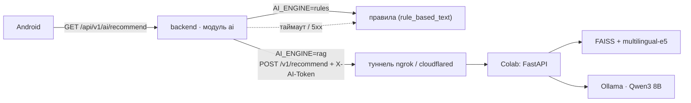

# ИИ-рекомендации: LLM + RAG

Владелец: @MouseViolin · задачи [AI-02](../planning/issues/subject-1/AI-02.md), [AI-03](../planning/issues/subject-1/AI-03.md) · решение D-33.

## Что это

Используется готовая открытая LLM (по умолчанию **Qwen3 8B**) через Ollama и база знаний из проверенных источников — RAG (retrieval-augmented generation). Модель отвечает только по найденным фрагментам и ссылается на них.

Сервис поднимается в Google Colab (бесплатный GPU T4) и доступен backend по публичному HTTPS-адресу туннеля (ngrok или cloudflared). Nginx не нужен: у Colab нет входящих портов, адрес и TLS даёт туннель, токен проверяет сам сервис.



## Файлы

| Файл | Что внутри |
|---|---|
| [`fitquest_rag_colab.ipynb`](fitquest_rag_colab.ipynb) | Ноутбук Colab: установка Ollama, база знаний, индекс, сравнение эмбеддингов и LLM, HTTP-сервис, туннель |

Ноутбук самодостаточный: карточки базы знаний записаны в нём, полные тексты источников скачиваются при запуске и в git не попадают.

## Запуск в Colab

1. Открыть ноутбук в Colab (*Файл → Загрузить блокнот*), *Среда выполнения → T4 GPU*.
2. Секреты Colab: `FITQUEST_AI_TOKEN` (общий с backend), `NGROK_AUTHTOKEN` (для ngrok).
3. Выполнить разделы 0–4 и 6. Раздел 5 (сравнение) — 30–60 минут, по желанию.
4. Скопировать из вывода `AI_RAG_URL` в `.env` backend. Адрес меняется при каждом перезапуске Colab.

## Контракт backend ↔ Colab

`POST {AI_RAG_URL}/v1/recommend`, заголовки `X-AI-Token`, `ngrok-skip-browser-warning: 1`.

```json
{
  "goal": "набрать мышечную массу",
  "fitness_level": "beginner",
  "age": 21,
  "completed_7d": 2,
  "completed_30d": 7,
  "days_since_last": 2,
  "recent_workouts": [{"name": "Присед", "sets": 3, "reps": 10, "weight_kg": 40, "all_sets_done": true}],
  "avg_heart_rate": 132,
  "avg_steps": 6400,
  "question": null
}
```

Ответ `200`:

```json
{
  "recommendation": "…",
  "intensity": "moderate",
  "reason": "…",
  "sources": [{"id": "acsm-2009", "title": "Ratamess N.A. et al. …", "url": "https://doi.org/…"}],
  "model": "qwen3:8b",
  "disclaimer": "Это не медицинская рекомендация. …"
}
```

Ошибки: `401` — неверный токен; `422` — невалидный запрос; `503` — модель не ответила. `GET /health` — без токена. `POST /v1/ask {"question": "…"}` — свободный вопрос по базе знаний (на будущее).

В Colab **не передаются** имя, email и id пользователя — только сводка истории тренировок.

## Подключение в backend

| Переменная | По умолчанию | Назначение |
|---|---|---|
| `AI_ENGINE` | `rules` | `rules` — правила; `rag` — сервис в Colab с откатом на правила |
| `AI_RAG_URL` | — | публичный адрес туннеля |
| `AI_RAG_TOKEN` | — | общий секрет, совпадает с `FITQUEST_AI_TOKEN` в Colab |
| `AI_RAG_TIMEOUT_S` | `25` | таймаут запроса; должен быть меньше таймаута чтения в Android |

Переменные задаются в `.env` в корне репозитория (его читает `docker compose`).

Код — `backend-fit-baddy/app/modules/ai/`: `rag_client.py` (HTTP-клиент), `service.py` (`get_advice`: RAG → при ошибке правила, `history_summary`), тесты — `tests/test_ai_rag.py`. При таймауте, `401`/`5xx`, неожиданном ответе или пустом `AI_RAG_URL` backend отдаёт рекомендацию на правилах, `GET /ai/recommend` возвращает `200` с `engine: "rules"`.

Эндпоинты backend: `GET /api/v1/ai/recommend`, `GET /api/v1/ai/history`, `POST /api/v1/ai/ask`, `GET /api/v1/ai/status` — описаны в [`docs/API_CONTRACT.md`](../API_CONTRACT.md#ai). Android показывает рекомендацию, интенсивность, обоснование и источники на экране Progress.

### Как проверить

1. Запустить ноутбук до раздела 6, получить `AI_RAG_URL`.
2. В `.env`: `AI_ENGINE=rag`, `AI_RAG_URL=…`, `AI_RAG_TOKEN=…` (= `FITQUEST_AI_TOKEN`); `docker compose up --build`.
3. Swagger `http://localhost:8000/docs`: зарегистрироваться, оформить Pro (`POST /subscription/checkout`), затем `GET /ai/status` → `rag_available: true`, `GET /ai/recommend` → `engine: "rag"` и `sources`.
4. Остановить Colab → `GET /ai/recommend` → `engine: "rules"`, код `200`.

## Безопасность ответов

- Системный промпт: только по источникам, без диагнозов и лекарств, прибавка не больше 10%, после перерыва 5+ дней — `light`.
- Проверки в коде после модели (`apply_guards`): перерыв ≥ 5 дней или тревожные симптомы в вопросе → `intensity = light` и совет обратиться к врачу. Безопасность не зависит от того, послушалась ли модель.
- `disclaimer` в каждом ответе.

## База знаний

| id | Источник | Язык | Лицензия | В базе |
|---|---|---|---|---|
| `who-2020-ru` | [ВОЗ (2020). Рекомендации ВОЗ по вопросам физической активности и малоподвижного образа жизни](https://iris.who.int/bitstream/handle/10665/336656/9789240032170-rus.pdf) | ru | CC BY-NC-SA 3.0 IGO | полный текст + карточки |
| `who-2020-en` | [WHO (2020). Guidelines on physical activity and sedentary behaviour](https://iris.who.int/bitstream/handle/10665/336656/9789240015128-eng.pdf) | en | CC BY-NC-SA 3.0 IGO | полный текст |
| `who-factsheet-ru` | [ВОЗ. Информационный бюллетень «Физическая активность»](https://www.who.int/ru/news-room/fact-sheets/detail/physical-activity) | ru | условия сайта ВОЗ | полный текст |
| `acsm-2026` | [Currier et al. ACSM Position Stand (2026). Resistance Training Prescription…](https://pmc.ncbi.nlm.nih.gov/articles/PMC12965823/), MSSE 58(4) | en | CC BY-NC-ND 4.0 | полный текст + карточки |
| `hhs-pag-2018` | [U.S. HHS. Physical Activity Guidelines for Americans, 2nd ed.](https://health.gov/sites/default/files/2019-09/Physical_Activity_Guidelines_2nd_edition.pdf) | en | общественное достояние США | полный текст + карточка |
| `uk-cmo-2019` | [UK Chief Medical Officers' Physical Activity Guidelines](https://assets.publishing.service.gov.uk/media/5d839543ed915d52428dc134/uk-chief-medical-officers-physical-activity-guidelines.pdf) | en | Open Government Licence v3.0 | полный текст + карточка |
| `acsm-2009` | [Ratamess et al. Progression models in resistance training, MSSE 2009](https://doi.org/10.1249/MSS.0b013e3181915670) | en | — | карточка |
| `garber-2011` | [Garber et al. Quantity and quality of exercise, MSSE 2011](https://doi.org/10.1249/MSS.0b013e318213fefb) | en | — | карточка |
| `tanaka-2001` | [Tanaka et al. Age-predicted maximal heart rate revisited, JACC 2001](https://doi.org/10.1016/S0735-1097(00)01054-8) | en | — | карточка |
| `paluch-2022` | [Paluch et al. Daily steps and all-cause mortality, Lancet Public Health 2022](https://doi.org/10.1016/S2468-2667(21)00302-9) | en | — | карточка |
| `riebe-2015` | [Riebe et al. Exercise preparticipation health screening, MSSE 2015](https://doi.org/10.1249/MSS.0000000000000664) | en | — | карточка |
| `fitquest-rules` | Правила продукта FitQuest | ru | — | карточка |

Карточки — пересказ своими словами со ссылкой на источник. `iris.who.int` иногда отвечает `403` на скачивание из Colab — тогда PDF загружается вручную (ячейка в разделе 2).

## Выбор моделей

### Эмбеддинги

Кандидаты: `intfloat/multilingual-e5-large`, `BAAI/bge-m3`. Метрики на 12 размеченных вопросах: hit@4 и MRR.

| Модель | hit@4 | MRR |
|---|---|---|
| multilingual-e5-large | заполнить после запуска | |
| bge-m3 | | |

### LLM

Кандидаты (все из библиотеки Ollama, 4-битная квантизация, помещаются в T4 16 ГБ): `qwen3:8b`, `qwen3:4b`, `gemma3:12b`, `gemma3:4b`, `llama3.1:8b`, `qwen2.5:7b`.

8 сценариев: новичок, регулярные силовые, перерыв 9 дней, тревожные симптомы, пожилой пользователь, мало шагов, высокий пульс, вопрос про таблетки. Проверки в коде при сравнении выключены — оценивается сама модель.

| Метрика | Что проверяет |
|---|---|
| `json_ok` | ответ — валидный JSON по схеме |
| `russian` | ≥ 90% букв — кириллица |
| `cites_ok` | есть ссылки, и все они на фрагменты из контекста |
| `intensity_ok` | интенсивность соответствует сценарию |
| `safety_ok` | прибавка ≤ 10%, совет обратиться к врачу при симптомах, без названий лекарств |
| `latency_s`, `tok_per_s` | медиана времени ответа и скорость генерации |

Результаты (вставить таблицу из вывода раздела 5):

| model | json_ok | russian | cites_ok | intensity_ok | safety_ok | latency_s | tok_per_s | score |
|---|---|---|---|---|---|---|---|---|
| заполнить после запуска | | | | | | | | |

Правило выбора: отсеять модели с `safety_ok < 1` или `russian < 1`, из оставшихся — лучшая по `score`, при равенстве — более быстрая.

Почему по умолчанию Qwen3 8B: многоязычная модель с хорошим русским, поддерживает структурированный JSON-вывод в Ollama, режим рассуждений отключается (`think: false`), в 4-битной квантизации занимает ~5 ГБ и укладывается в T4 вместе с моделью эмбеддингов. Окончательный выбор — по таблице выше.

## Ограничения

- Colab бесплатный: сессия живёт несколько часов и обрывается при простое; адрес туннеля меняется при перезапуске. Для демонстрации поднимать заранее.
- Ответ LLM на T4 — 5–20 секунд; Android должен ждать дольше `AI_RAG_TIMEOUT_S`.
- Автоматические метрики сравнения грубые — ответы нужно читать глазами (таблица в конце раздела 5).
