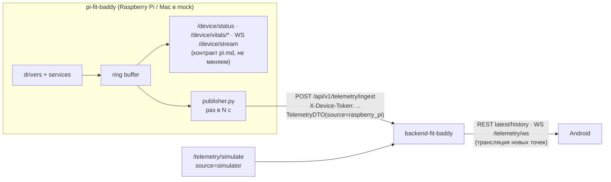

# Матрица трассировки требований FitQuest

> Фаза 2 аудита, обновлено после фазы 5 (исправления дефектов и тесты). Состояние на **14.10.2026**.
> Тесты: backend — 77 (pytest, SQLite и PostgreSQL 16), Android — 14 (JUnit). Ручные сценарии — `docs/TESTING.md`, раздел «Ручные проверки» (M-01…M-10).
> Проверка: чтение кода `backend-fit-baddy/`, `mobile-fit-baddy/`, прогон `pytest` (8/8 зелёные, Python 3.11, SQLite),
> сборка `./gradlew assembleDebug` (успешно, unit-тестов 0), ручной зонд API через `TestClient` (результаты — раздел 5).

**Легенда статуса:** ✅ сделано · 🟡 частично · ❌ нет · ⏸ предлагается вынести из MVP (нужно согласие владельца проекта).

**Владельцы.**
По модулям: Аккаунт/расписание — @NastyaZhilinaRis2 · Тренировки — @Hupubu · Питомец — @SonyAkb · Дашборд/уведомления — @Ananasic07 · ИИ/устройства/подписка — @MouseViolin.

**Обозначения путей.** `be/` = `backend-fit-baddy/app/`, `and/` = `mobile-fit-baddy/app/src/main/java/com/fitquest/app/`, `T:` = тест в `backend-fit-baddy/tests/test_api.py`.

---

## 0. Сводка

| Набор требований | Всего | ✅ | 🟡 | ❌ | ⏸ предложено вынести |
|---|---|---|---|---|---|
| A. Продуктовые критерии US-A1…US-H2 (`docs/requirements/PRODUCT_USER_STORIES.md`) | 88 | 10 | 31 | 47 | 9 (из числа ❌/🟡) |
| B. API-критерии AC1.1…AC12.6 + AC-G (`docs/requirements/ACCEPTANCE_CRITERIA.md`) | 89 | 78 | 9 | 1 | — |
| C. Модуль Raspberry Pi (`docs/pi.md`) | 33 | 0 | 0 | 33 | — |

Вывод: **API-контур MVP (набор B) готов**, кроме офлайн-кэша на Android (AC12.5), демо-сценарий из `CLAUDE.md` проходит сквозным тестом `test_full_demo_path`.
**Продуктовые критерии (набор A)** написаны на уровне «полноценного приложения» и закрыты слабо — прежде всего UI Android (таймер отдыха, чек-лист, календарь, квесты, тарифы, графики).
**Модуль Pi (набор C) не начат** — в `pi-fit-baddy/` пока только README и `.gitignore`.

---

## 1. Набор A — продуктовые критерии приёмки (README, US-A1…US-H2)

### A — Знакомство (@NastyaZhilinaRis2)

| US | Критерий | Модуль | Владелец | Статус | Где в коде | Тест | Комментарий |
|---|---|---|---|---|---|---|---|
| US-A1 | 1. Регистрация: поля email, пароль, **подтверждение пароля** | auth | NastyaZhilinaRis2 | 🟡 | `and/ui/AuthActivity.java`, `res/layout/activity_auth.xml` | — | Поля подтверждения пароля нет |
| US-A1 | 1. Валидация email (формат, уникальность) | auth | NastyaZhilinaRis2 | ✅ | `be/modules/auth/schemas.py` (`EmailStr`), `router.py` 409 | T:`test_register_and_login` | Уникальность проверяется, тест на 409 отсутствует |
| US-A1 | 1. Пароль ≥ 8 символов, **буквы и цифры** | auth | NastyaZhilinaRis2 | ✅ | `RegisterIn.letters_and_digits`; `auth/AuthValidator.java` | `test_auth.py`, `AuthValidatorTest` | Исправлено 14.10.2026 |
| US-A1 | 1. Отображение ошибок валидации | auth | NastyaZhilinaRis2 | 🟡 | `AuthActivity` → `toast(...)` | — | Ошибки тостом, не у поля |
| US-A1 | 2. Вход: email + пароль, успех → приложение | auth | NastyaZhilinaRis2 | ✅ | `POST /auth/login`, `AuthActivity` → `MainActivity` | T:`test_register_and_login` | |
| US-A1 | 2. Ошибка → «Неверный email или пароль» | auth | NastyaZhilinaRis2 | 🟡 | 401 `Invalid email or password` | — | Текст на английском |
| US-A1 | 2. Ссылка «Забыли пароль?» | auth | NastyaZhilinaRis2 | ❌ ⏸ | — | — | Противоречие П-5. Предложение: ссылка-заглушка «обратитесь к администратору», реальный сброс — вне MVP |
| US-A1 | 3. Автовход при повторном открытии | auth | NastyaZhilinaRis2 | ✅ | `ui/SplashActivity.java` + `auth/SessionStore.java` (EncryptedSharedPreferences) | вручную | |
| US-A1 | 3. Кнопка «Выйти» | auth | NastyaZhilinaRis2 | ✅ | `ProfileFragment.logout()` | вручную | Не обнуляет токен на сервере (refresh не отзывается) |
| US-A2 | 1. Экран профиля после регистрации, можно пропустить | profile | NastyaZhilinaRis2 | ❌ | — | — | После регистрации сразу главный экран |
| US-A2 | 1. Доступ «Настройки → Мой профиль» | profile | NastyaZhilinaRis2 | ✅ | вкладка Pack → `ProfileFragment` | вручную | |
| US-A2 | 2. «Цель» — выбор из 4 вариантов, обязательно | profile | NastyaZhilinaRis2 | 🟡 | `Profile.goal` (свободная строка), `inputGoal` (текст) | — | Нет enum и выпадающего списка |
| US-A2 | 3. Вес 30–300 кг, цифровая клавиатура | profile | NastyaZhilinaRis2 | 🟡 | `ProfileUpdateIn.weight_kg` (30–300) | `test_auth.py::test_profile_rejects_weight_out_of_range` | Сервер проверяет; в Android поле не числовое |
| US-A2 | 4. Уровень: 3 варианта, по умолчанию «Новичок» | profile | NastyaZhilinaRis2 | 🟡 | `Profile.fitness_level` (строка, default `null`) | — | Нет enum и дефолта |
| US-A2 | 5. «Начать тренировки» активна при заполненных полях | profile | NastyaZhilinaRis2 | ❌ | — | — | Есть только «Сохранить» |

### B — Мой план

| US | Критерий | Модуль | Владелец | Статус | Где в коде | Тест | Комментарий |
|---|---|---|---|---|---|---|---|
| US-B1 | 1. «Создать программу», название обязательно | workouts | Hupubu | ✅ | `POST /workouts/plans`, `WorkoutFragment.showCreatePlanDialog` | T:`test_create_plan_start_and_complete_workout` | |
| US-B1 | 1. Выбор иконки/цвета | workouts | Hupubu | ❌ ⏸ | — | — | Косметика, предлагаю вне MVP |
| US-B1 | 2. Поиск по названию, фильтр по группам мышц, каталог | workouts | Hupubu | ❌ | — | — | Нет таблицы `exercises` (каталога), упражнение — свободный текст |
| US-B1 | 3. Подходы 1–10, повторы 1–50, вес, заметки | workouts | Hupubu | 🟡 | `ExerciseIn` (`ge=1`, без верхней границы), нет `notes` | — | Диалог Android добавляет **одно** упражнение на план |
| US-B1 | 4. Редактирование/удаление/дублирование, перерывы | workouts | Hupubu | ❌ | только `rest_seconds` в модели | — | Нет `PATCH/DELETE /workouts/plans/{id}` |
| US-B1 | 5. Отображение: упражнения (подходы×повторы×вес), количество, время | workouts | Hupubu | 🟡 | `item_plan.xml` | вручную | Примерного времени нет |
| US-B2 | 1. Календарь месяц/неделя, цвет программ | schedule | NastyaZhilinaRis2 | ❌ | — | — | Экрана расписания на Android нет |
| US-B2 | 2. Добавление: дата, программа, время, повтор | schedule | NastyaZhilinaRis2 | 🟡 | `POST /schedule` (`repeat_rule`), Android — только «Pin as today» | — | |
| US-B2 | 3. Настройка повторений, предпросмотр | schedule | NastyaZhilinaRis2 | ❌ | `repeat_rule` хранится, но не разворачивается | — | |
| US-B2 | 4. Список сегодня/завтра/неделя, быстрый старт | schedule | NastyaZhilinaRis2 | 🟡 | `dashboard.today_schedule`, `HomeFragment.todayQuest` | вручную | Только «сегодня» |
| US-B2 | 5. Отмена (с вопросом о повторах), редактирование, замена | schedule | NastyaZhilinaRis2 | 🟡 | `PATCH/DELETE /schedule/{id}` | — | API есть, UI нет |
| US-B3 | 1. «Перенести», окно 24 ч, недоступно для прошедших | schedule | NastyaZhilinaRis2 | ❌ | — | — | Противоречие П-4 |
| US-B3 | 2. Выбор даты/времени, подсветка занятых слотов | schedule | NastyaZhilinaRis2 | ❌ | — | — | |
| US-B3 | 3. Конфликты: перенести/другое/заменить | schedule | NastyaZhilinaRis2 | ❌ | — | — | Предлагаю упростить до «409 + выбрать другое» |
| US-B3 | 4. Перенос повторяющихся (одна/все) | schedule | NastyaZhilinaRis2 | ❌ ⏸ | — | — | Зависит от RRULE |
| US-B3 | 5. Подтверждение старой/новой даты, уведомление | schedule | NastyaZhilinaRis2 | ❌ | — | — | |

### C — На тренировке (@Hupubu)

| US | Критерий | Модуль | Владелец | Статус | Где в коде | Тест | Комментарий |
|---|---|---|---|---|---|---|---|
| US-C1 | 1. «Начать» из расписания/программ, название, кол-во упражнений | workouts | Hupubu | 🟡 | `WorkoutFragment.startSession`, `HomeFragment.btnStartQuest` | T:`test_create_plan_start_and_complete_workout` | Счётчиков упражнений/подходов на экране нет |
| US-C1 | 2. Экран упражнения «2 из 8», описание | workouts | Hupubu | ❌ | — | — | Отдельного экрана выполнения нет — только баннер «Quest in progress · N s» |
| US-C1 | 3. Чек-лист подходов, факт. значения | workouts | Hupubu | ❌ | — | — | Нет `workout_session_exercises`/`exercise_sets` |
| US-C1 | 4. Таймер отдыха (30/60/90/120, пауза, +30) | workouts | Hupubu | ❌ | — | — | Есть только общий секундомер сессии (`SessionStore.elapsedSeconds`) |
| US-C1 | 5. Навигация «Следующее/Предыдущее», прогресс | workouts | Hupubu | ❌ | — | — | |
| US-C1 | 6. «Завершить», подтверждение, сохранение | workouts | Hupubu | 🟡 | `POST /sessions/{id}/complete`, `completeSession()` | T:`test_complete_is_idempotent` | Нет подтверждения при незакрытых подходах |
| US-C2 | 1. Отметка подхода, автозапуск таймера | workouts | Hupubu | ❌ | — | — | |
| US-C2 | 2. Пропуск подхода/упражнения | workouts | Hupubu | ❌ | — | — | |
| US-C2 | 3. Статистика (время, подходы, объём), заметки | workouts | Hupubu | 🟡 | `duration_seconds` | — | Подходов/объёма/заметок нет |
| US-C2 | 4. Запись в историю, статистика, уведомление питомцу | workouts | Hupubu | ✅ | `WorkoutCompleted` → pet/notifications | T:`test_full_demo_path` | |
| US-C2 | 5. Редактирование 24 ч, история изменений, удаление | workouts | Hupubu | ❌ ⏸ | — | — | Предлагаю вне MVP (кроме удаления) |
| US-C3 | 1. Список новые→старые: дата, программа, длительность, статус | workouts | Hupubu | ✅ | `GET /workouts/history`, `item_session.xml` | T:`test_create_plan_start_and_complete_workout` | |
| US-C3 | 2. Фильтрация/сортировка | workouts | Hupubu | ❌ | — | — | Нет параметров `limit/offset/from/to/plan_id` |
| US-C3 | 3. Детали: упражнения с подходами | workouts | Hupubu | 🟡 | `GET /sessions/{id}` | — | Без подходов (нет данных) |
| US-C3 | 4. Статистика (кол-во, средняя длительность) | workouts/dashboard | Hupubu | 🟡 | `history.total` | — | |
| US-C3 | 5. Экспорт PDF/CSV | workouts | Hupubu | ❌ ⏸ | — | — | MoSCoW W6 — Won't |

### D — Мой питомец (@SonyAkb)

| US | Критерий | Модуль | Владелец | Статус | Где в коде | Тест | Комментарий |
|---|---|---|---|---|---|---|---|
| US-D1 | 1. Питомец на главном, уровень | pet | SonyAkb | ✅ | `HomeFragment` (`fox`, `level`, `xpBar`), `UiFormat.foxForMood` | вручную | |
| US-D1 | 2. Уровни 1–50, +10 XP за тренировку, +5 за серию, прогресс-бар | pet | SonyAkb | 🟡 | `pet/service.py` `XP_PER_WORKOUT=25`, `XP_PER_LEVEL=100` | T:`test_xp_and_level_after_complete` | Противоречие П-7: числа XP не совпадают; бонуса за серию и потолка 50 нет |
| US-D1 | 3. Анимация получения опыта, сообщения питомца | pet | SonyAkb | 🟡 | `fox_idle_animation.xml`, кадры в `drawable-nodpi` | вручную | Анимация простоя есть; анимации XP и реплик нет |
| US-D1 | 4. Статистика: уровень, опыт, тренировки, дни без пропусков, общее время | pet | SonyAkb | 🟡 | `PetOut` (xp, level, streak) | — | Нет общего времени/кол-ва тренировок в `/pet` |
| US-D2 | 1. Фиксация пропуска, дни с последней тренировки | pet/schedule | SonyAkb | 🟡 | `POST /schedule/{id}/miss` → `WorkoutMissed`, `Pet.last_activity_date` | — | Пропуск только **вручную**; автоматического детектора нет |
| US-D2 | 2. 7 дней → грустит, 14+ → спит | pet | SonyAkb | ❌ | `apply_workout_missed` → сразу `sad` | — | Противоречие П-3; состояния `sleeping` нет |
| US-D2 | 3. Сообщения на 1/2/3/5/7+ день | pet/notifications | SonyAkb | ❌ | — | — | |
| US-D2 | 4. Push на 2-й и 5-й день | notifications | Ananasic07 | ❌ | — | — | Противоречие П-3, П-12 (push = Won't) |
| US-D2 | 5. Возвращение: «Рад тебя видеть!», бонус XP | pet | SonyAkb | ❌ | — | — | |
| US-D3 | 1. Список квестов: условие, прогресс, награда, срок | pet | SonyAkb | ✅ | `GET /pet/quests`, `pet/service.quest_out` | T:`test_quests_endpoint_shape_and_auth` | |
| US-D3 | 2. Типы: ежедневные/еженедельные/достижения | pet | SonyAkb | ✅ | `quests.period=daily\|weekly`, `achievements` | T:`test_daily_quest_completes_on_first_workout_and_awards_xp`, `test_weekly_quest_needs_three_workouts` | |
| US-D3 | 3. Автообновление прогресса, уведомление | pet | SonyAkb | ✅ | `pet/handlers.on_workout_completed` → `apply_quest_progress`, `quest_completed` → notifications | T:`test_full_event_path_updates_quest_progress`, `test_quest_completion_creates_notification` | |
| US-D3 | 4. Награды: XP, значки | pet | SonyAkb | ✅ | `award_xp` (квест + достижение) | T:`test_achievement_xp_is_awarded` | |
| US-D3 | 5. История достижений с датой | pet | SonyAkb | ✅ | `GET /pet/achievements` (`earned_at`) | T:`test_achievements_endpoint_returns_earn|

### E — Мои результаты (@Ananasic07)

| US | Критерий | Модуль | Владелец | Статус | Где в коде | Тест | Комментарий |
|---|---|---|---|---|---|---|---|
| US-E1 | 1. Период (неделя/месяц/…), показатели: тренировки, объём, время, серия | dashboard | Ananasic07 | 🟡 | `GET /dashboard/summary`, `ProgressFragment` | T:`test_xp_and_level_after_complete` | Только «неделя», параметра `period` нет; объёма и среднего времени нет |
| US-E1 | 2. Графики по упражнениям (вес/повторы/объём) | dashboard | Ananasic07 | ❌ | — | — | Нет данных по подходам |
| US-E1 | 3. Линейный/столбчатый график, тепловая карта | dashboard | Ananasic07 | ❌ | `workouts_by_day=[]` всегда пустой | — | |
| US-E1 | 4. Сравнение периодов, тренд | dashboard | Ananasic07 | ❌ ⏸ | — | — | |
| US-E1 | 5. «Поделиться» картинкой | dashboard | Ananasic07 | ❌ ⏸ | — | — | |
| US-E2 | 1. Календарь месяца, навигация, текущая дата | dashboard | Ananasic07 | ❌ | — | — | |
| US-E2 | 2. Цвет тренировок, серые дни | dashboard | Ananasic07 | ❌ | — | — | |
| US-E2 | 3. Клик по дню → список; пропуски красным | dashboard | Ananasic07 | ❌ | — | — | |

### F — Поддержка (@Ananasic07)

| US | Критерий | Модуль | Владелец | Статус | Где в коде | Тест | Комментарий |
|---|---|---|---|---|---|---|---|
| US-F1 | 1. Настройка напоминаний (1ч/30/15/5 мин) | notifications | Ananasic07 | ❌ | — | — | |
| US-F1 | 2. Push «Через 30 мин: …», звук/вибрация | notifications | Ananasic07 | ❌ | — | — | Предлагаю: локальные уведомления Android (`AlarmManager`/`WorkManager`) без FCM — П-12 |
| US-F1 | 3. Клик → приложение, long-press-действия | notifications | Ananasic07 | ❌ ⏸ | — | — | Действия в уведомлении — вне MVP |
| US-F2 | 1. Триггеры 2/5/7/14+, возвращение, достижения | notifications | Ananasic07 | 🟡 | `notifications/handlers.py`: completed, missed, level-up | T:`test_xp_and_level_after_complete` | Есть реакции на события, триггеров «N дней без тренировок» нет |
| US-F2 | 2. База фраз, случайный выбор | notifications | Ananasic07 | ❌ | тексты захардкожены на английском | — | |
| US-F2 | 3. Отключение мотивационных уведомлений | notifications | Ananasic07 | ❌ | — | — | |

### G — Подписка (@MouseViolin)

| US | Критерий | Модуль | Владелец | Статус | Где в коде | Тест | Комментарий |
|---|---|---|---|---|---|---|---|
| US-G1 | 1. Экран тарифов Free/Pro, текущий выделен | subscription | MouseViolin | 🟡 | `ProfileFragment` (`plan`, `btnCheckout`) | вручную | Отдельного экрана тарифов нет |
| US-G1 | 2. Таблица функций (Free: 2 программы, Pro: безлимит…) | subscription | MouseViolin | ❌ | `PRO_ENTITLEMENTS=["ai_recommendations"]` | — | Лимит «2 программы» не реализован |
| US-G1 | 3. Цена месяц/год | subscription | MouseViolin | ❌ | `Payment.amount=999` захардкожено | — | |
| US-G2 | 1. Выбор периода месяц/год | subscription | MouseViolin | ❌ | `CheckoutIn.plan` игнорируется | — | |
| US-G2 | 2. Шаги оплаты (подтверждение, способ, биометрия) | subscription | MouseViolin | 🟡 ⏸ | mock checkout сразу активирует Pro | — | Биометрию предлагаю вне MVP; mock-шаги «подтверждение → webhook» — оставить |
| US-G2 | 3. «Активирована!», дата списания, доступ сразу | subscription | MouseViolin | 🟡 | `CheckoutOut.message`; `current_period_end=None` | T:`test_mock_webhook_idempotency` | |
| US-G2 | 4. Ошибки оплаты (нет средств, сеть, отмена) | subscription | MouseViolin | 🟡 | webhook `payment.failed` → платёж `failed`, тариф прежний | `test_ai_subscription.py::test_failed_payment_keeps_free_plan` | Экранов ошибок в Android нет |
| US-G2 | 5. Статус, окончание, «Отменить», доступ до конца периода | subscription | MouseViolin | ❌ | — | — | |

### H — Умные функции (@MouseViolin)

| US | Критерий | Модуль | Владелец | Статус | Где в коде | Тест | Комментарий |
|---|---|---|---|---|---|---|---|
| US-H1 | 1. Разрешение, выбор данных (шаги/пульс/калории/минуты), отзыв | devices | MouseViolin | 🟡 | `POST /devices/register`, `TelemetryFragment.btnRegister` | T:`test_telemetry_simulate_stores_a_point` | Нет отзыва устройства, выбора метрик, «минут» (П-6) |
| US-H1 | 2. Синхронизация: при открытии, фоновая, ручная, индикатор | devices | MouseViolin | 🟡 | WS + REST-поллинг (`btnPoll`), статус-строка | вручную | Фоновой синхронизации нет |
| US-H1 | 3. «Активность»: сегодня, график неделя/месяц | devices | MouseViolin | 🟡 | `TelemetryFragment` (latest + список history) | вручную | Графика нет |
| US-H2 | 1. Анализ: частота, прогресс, время с последней, цели | ai | MouseViolin | 🟡 | `ai/service.rule_based_text(completed_count)` | — | Учитывается только количество тренировок |
| US-H2 | 2. Рекомендация: программа, интенсивность, обоснование | ai | MouseViolin | 🟡 | `GET /ai/recommend` → `text`, `reason` (константа), `disclaimer` | — | Нет поля интенсивности; `reason` одинаковый всегда. Модели из Colab нет |

> В README критерии US-H2 обрываются на п.2 — если были ещё пункты, их нужно восстановить.

---

## 2. Набор B — API-критерии (`docs/ACCEPTANCE_CRITERIA.md`)

| AC | Суть | Модуль / владелец | Статус | Где | Тест | Комментарий |
|---|---|---|---|---|---|---|
| AC1.1 | Регистрация → 201 + JWT, `goal=null` | auth / NastyaZhilinaRis2 | ✅ | `auth/router.register` | T:`test_register_and_login` | |
| AC1.2 | Дубликат → 409 | auth / NastyaZhilinaRis2 | ✅ | `auth/router.register` | `test_auth.py::test_register_duplicate_email_conflicts` | |
| AC1.3 | Пароль < 8 → 422 | auth / NastyaZhilinaRis2 | ✅ | `RegisterIn` (+ буквы и цифры) | `test_auth.py::test_register_rejects_short_password`, `…_without_digits_or_letters` | |
| AC1.4 | Питомец создаётся при регистрации | pet / SonyAkb | ✅ | `USER_REGISTERED` → `pet/handlers` | T:`test_xp_and_level_after_complete` | |
| AC1.5 | `PATCH /profile` goal → виден в `/auth/me` | profile / NastyaZhilinaRis2 | ✅ | `auth/service.update_profile` | `test_auth.py::test_profile_update_is_visible_in_me_and_not_reset` | |
| AC1.6 | `goal` не обнуляется | profile / NastyaZhilinaRis2 | ✅ | `exclude_unset=True` | `test_auth.py::test_profile_update_is_visible_in_me_and_not_reset` | |
| AC2.1 | Вход → 200 + JWT + user | auth | ✅ | `login` | T:`test_register_and_login` | |
| AC2.2 | Неверные данные → 401 | auth | ✅ | `login` | T:`test_register_and_login` | |
| AC2.3 | `GET /schedule?from&to` | schedule / NastyaZhilinaRis2 | ✅ | `auth/service.list_schedule` | `test_schedule.py::test_schedule_is_filtered_by_date_range` | Исправлено 14.10.2026 |
| AC2.4 | Пустое расписание → `[]` | schedule | ✅ | | `test_schedule.py::test_empty_schedule_returns_empty_list` | |
| AC2.5 | `GET /workouts/plans/{id}` с упражнениями | workouts / Hupubu | ✅ | | T:`test_create_plan_start_and_complete_workout` | |
| AC2.6 | План без упражнений → `exercises: []` | workouts | ✅ | | `test_workouts.py::test_plan_without_exercises_has_empty_list` | |
| AC3.1 | Создание плана 201 | workouts | ✅ | | T:`test_create_plan_…` | |
| AC3.2 | Создание слота 201, `status=planned` | schedule | ✅ | | `test_schedule.py::test_create_slot_is_planned` | |
| AC3.3 | `starts_at` в прошлом → 422 | schedule | ✅ | `auth/schemas._require_not_past` (допуск 15 мин) | `test_schedule.py::test_slot_in_the_past_is_rejected`, `test_moving_slot_to_the_past_is_rejected` | Исправлено 14.10.2026 (Д-4) |
| AC3.4 | Несуществующий `plan_id` → 404 | schedule | ✅ | `create_schedule` | `test_schedule.py::test_slot_with_unknown_plan_is_not_found` | Импорт `workouts.service` — разрешённый вызов (ARCHITECTURE §5) |
| AC3.5 | `PATCH /schedule/{id}` | schedule | ✅ | | `test_schedule.py::test_update_and_delete_slot` | |
| AC3.6 | `DELETE /schedule/{id}` → 204 | schedule | ✅ | | `test_schedule.py::test_update_and_delete_slot` | |
| AC3.7 | Удаление несуществующего → 404 | schedule | ✅ | | `test_schedule.py::test_update_and_delete_slot` | |
| AC4.1 | Старт сессии 201, `in_progress` | workouts | ✅ | | T:`test_create_plan_…` | |
| AC4.2 | Без `plan_id` → 422 | workouts | ✅ | `SessionStartIn.require_plan` | `test_workouts.py::test_session_requires_plan_id` | |
| AC4.3 | Таймер локальный | workouts / AND | ✅ | `SessionStore.elapsedSeconds` | вручную | |
| AC4.4 | Повторный старт | workouts | ✅ | создаётся новая сессия (D-04) | `test_workouts.py::test_second_session_for_same_plan_is_allowed` | |
| AC4.5 | Complete без тела → длительность по времени | workouts | ✅ | `complete_session` | T:`test_complete_is_idempotent` | |
| AC4.6 | Complete с `duration_seconds` | workouts | ✅ | | `test_workouts.py::test_complete_with_explicit_duration` | |
| AC5.1 | `xp_awarded` в ответе (≥ +10) | workouts / Hupubu | ✅ | `xp_awarded = 25` | T:`test_full_demo_path` | **Захардкожено в модуле тренировок** — дублирует константу питомца |
| AC5.2 | `/pet.xp` вырос на `xp_awarded` | pet / SonyAkb | ✅ | | T:`test_xp_and_level_after_complete` | |
| AC5.3 | Level-up, `xp_to_next_level = level*100` | pet | 🟡 | `XP_PER_LEVEL=100` плоский | `test_pet.py::test_level_up_when_threshold_reached` | Level-up работает; формула D-13 (`level×100`, бонус серии, максимум 50) — задача питомца |
| AC5.4 | mood `happy`/`level_up` | pet | ✅ | | T:`test_xp_and_level_after_complete` | |
| AC5.5 | Стрик не сбивается в тот же день | pet | ✅ | `apply_workout_completed` | `test_pet.py::test_streak_counts_consecutive_days_only` | |
| AC5.6 | `/schedule/{id}/miss` → `missed` + событие | schedule | ✅ | | `test_schedule.py::test_miss_slot_marks_missed_once` | |
| AC5.7 | После пропуска mood хуже, энергия ниже | pet | ✅ | `apply_workout_missed` | `test_pet.py::test_missed_slot_affects_pet_via_event` | |
| AC5.8 | Повторный complete → 409 | workouts | ✅ | | T:`test_complete_is_idempotent` | |
| AC6.1 | `/pet` содержит все поля | pet | ✅ | `PetOut` | T:`test_xp_and_level_after_complete` | |
| AC6.2–6.4 | Инварианты energy/level/xp | pet | ✅ | clamp в сервисе | `test_pet.py::test_energy_stays_within_bounds` | |
| AC6.5 | Стрик в дашборде = стрик питомца | dashboard / Ananasic07 | ✅ | | `test_pet.py::test_xp_is_consistent_between_pet_and_dashboard` | Через публичную функцию `pet.service` (D-06) |
| AC6.6 | Нет питомца → создаётся | pet | ✅ | `get_or_create_pet` | `test_pet.py::test_new_pet_defaults` | |
| AC7.1 | `POST /devices/register` 201, `status=active` | devices / MouseViolin | ✅ | | T:`test_telemetry_simulate_…` | |
| AC7.2 | Повторная регистрация | devices | ✅ | своё → 200, чужое → 409 (D-05) | `test_devices.py::test_register_same_device_twice_is_idempotent`, `…_of_another_user_conflicts_without_leaking_token` | Исправлено 14.10.2026 (Д-6) |
| AC7.3 | `simulate` → 201, `source=simulator` | devices | ✅ | | T:`test_telemetry_simulate_…` | |
| AC7.4 | Отрицательные значения → 422 | devices | ✅ | `TelemetrySimulateIn` (`ge=0`) | `test_devices.py::test_simulate_rejects_negative_values` | Исправлено 14.10.2026 (Д-5) |
| AC7.5 | `GET /telemetry/latest` | devices | ✅ | | T:`test_telemetry_simulate_…` | |
| AC7.6 | Нет точек → 404 | devices | ✅ | | `test_devices.py::test_latest_without_points_is_not_found` | |
| AC7.7 | `history?from&to` | devices | ✅ | `devices/service.list_history` | `test_devices.py::test_history_is_filtered_by_period` | Исправлено 14.10.2026 |
| AC7.8 | WS с токеном шлёт DTO **при появлении новых точек** | devices | 🟡 | `telemetry_ws` | `test_devices.py::test_websocket_streams_telemetry_dto`, `…_rejects_invalid_token` | WS всё ещё сам генерирует синтетику; рассылка сохранённых точек — задача D-17 |
| AC7.9 | `simulate` без регистрации | devices | ✅ | `get_or_create_simulator_device` | `test_devices.py::test_simulate_without_registration_creates_device` | |
| AC8.1 | `/dashboard/summary?period=week` агрегаты | dashboard | 🟡 | | T:`test_full_demo_path` | `period` не принимается |
| AC8.2 | Обязательные поля сводки | dashboard | 🟡 | `DashboardSummaryOut` | `test_notifications.py::test_dashboard_summary_fields` | Поля есть, но `steps_7d` = последнее значение, `workouts_by_day` пуст — задача дашборда |
| AC8.3 | `history?limit&offset` | workouts | ✅ | `workouts/service.history_out` | `test_workouts.py::test_history_is_paginated_newest_first` | Исправлено 14.10.2026 |
| AC8.4 | `offset` за пределами → `[]` | workouts | ✅ | | `test_workouts.py::test_history_is_paginated_newest_first` | |
| AC8.5 | Телеметрия за период с `source` | devices | ✅ | | `test_devices.py::test_history_is_filtered_by_period` | |
| AC8.6 | История по умолчанию — последние 20 | workouts | ✅ | `limit=20` | `test_workouts.py::test_history_defaults_to_20_items` | |
| AC9.1 | Уведомление `workout_completed` | notifications / Ananasic07 | ✅ | `notifications/handlers` | T:`test_xp_and_level_after_complete` | |
| AC9.2 | Уведомление `workout_missed` | notifications | ✅ | | `test_notifications.py::test_completed_and_missed_workouts_create_notifications` | |
| AC9.3 | Список, новые сверху | notifications | ✅ | | `test_notifications.py::test_completed_and_missed_workouts_create_notifications` | |
| AC9.4 | `unread_only=true` | notifications | ✅ | `notifications/service.list_notifications` | `test_notifications.py::test_mark_read_and_unread_filter` | Исправлено 14.10.2026 |
| AC9.5 | `POST /{id}/read` → `is_read=true` | notifications | ✅ | | `test_notifications.py::test_mark_read_and_unread_filter` | |
| AC9.6 | Без read остаётся `false` | notifications | ✅ | | — | |
| AC9.7 | Пустой центр → `[]` | notifications | ✅ | | `test_notifications.py::test_empty_notification_center` | |
| AC9.8 | Лимит (50) | notifications | ✅ | `limit` (по умолчанию 50) | `test_notifications.py::test_notification_limit` | Исправлено 14.10.2026 |
| AC10.1 | Pro → рекомендация с `reason`, `disclaimer` | ai / MouseViolin | ✅ | | `test_ai_subscription.py::test_checkout_activates_pro_and_unlocks_ai` | |
| AC10.2 | Free → 403 | ai / subscription | ✅ | `ai/router` + `subscription.service.can_use` | `test_ai_subscription.py::test_ai_requires_pro` | Исправлено 14.10.2026 (Д-3) |
| AC10.3 | `GET /ai/history` | ai | ✅ | | — | |
| AC10.4 | Пустая история → `[]` | ai | ✅ | | `test_ai_subscription.py::test_ai_history_is_empty_initially` | |
| AC10.5 | Не голая заглушка, есть `reason` | ai | 🟡 | `reason` — константа | — | |
| AC10.6 | `disclaimer` всегда | ai | ✅ | `DISCLAIMER` | — | |
| AC11.1 | `GET /subscription` | subscription | ✅ | | T:`test_mock_webhook_idempotency` | |
| AC11.2 | Free по умолчанию | subscription | ✅ | `USER_REGISTERED` handler | `test_ai_subscription.py::test_new_user_is_on_free_plan` | |
| AC11.3 | Mock checkout → `checkout_id`, `mock=true` | subscription | ✅ | `SandboxPaymentProvider` | `test_ai_subscription.py::test_checkout_activates_pro_and_unlocks_ai` | Sandbox подтверждает сразу; `pending`-провайдер Pro не включает (`test_pending_provider_does_not_activate_pro`) |
| AC11.4 | Webhook первый раз → `duplicate=false` | subscription | ✅ | | T:`test_mock_webhook_idempotency` | |
| AC11.5 | Повтор → `duplicate=true` | subscription | ✅ | | T:`test_mock_webhook_idempotency` | |
| AC11.6 | Без/с неверным `X-Mock-Signature` → 403 | subscription | ✅ | `subscription/router.webhook` | `test_ai_subscription.py::test_webhook_without_or_with_wrong_signature_is_forbidden` | Исправлено 14.10.2026 (Д-1) |
| AC11.7 | Секрет из env | subscription | ✅ | `MOCK_WEBHOOK_SECRET`, `hmac.compare_digest` | то же | |
| AC11.8 | После Pro — доступ к AI | ai/subscription | ✅ | | `test_ai_subscription.py::test_checkout_activates_pro_and_unlocks_ai` | |
| AC12.1 | Живой WS, статус «онлайн» | devices / AND | ✅ | `TelemetryWebSocket`, `TelemetryFragment` | вручную | |
| AC12.2 | Обрыв WS → «офлайн» | devices / AND | ✅ | `onFailure` → `startPolling("WS failed…")` | вручную | |
| AC12.3 | Fallback на REST latest | devices / AND | ✅ | `refreshLatest()` | вручную | |
| AC12.4 | 404 → «нет данных» | devices / AND | 🟡 | | вручную | Требует проверки текста |
| AC12.5 | REST недоступен → кэш последней точки | devices / AND | ❌ | — | — | Последняя точка не кэшируется |
| AC12.6 | «офлайн, последнее известное» с датой | devices / AND | 🟡 | `status` строка | вручную | Без даты точки |
| AC-G1 | Без JWT → 401 | core | ✅ | `core/deps.get_current_user` | T:`test_unauthorized_access` | |
| AC-G2 | Доступ к чужим данным | core | ✅ | все запросы фильтруются по `user_id` | — | |
| AC-G3 | Просроченный JWT → 401 | core | ✅ | `core/security.decode_token` | `test_auth.py::test_expired_access_token_is_unauthorized`, `test_refresh_token_is_not_accepted_as_access_token` | Д-2 исправлено 14.10.2026 |
| AC-G4 | Swagger = `API_CONTRACT.md` | core | 🟡 | `/docs` | — | Расхождения остались только в пунктах «(план)»: `/telemetry/ingest`, WS-рассылка |
| AC-G5 | Нет NaN/Infinity в телеметрии | devices | ✅ | `int` поля | — | |
| AC-G6 | ISO-8601 UTC | core | ✅ | `DateTime(timezone=True)` | — | На SQLite tz теряется — проверить на PostgreSQL |
| AC-G7 | 4xx/5xx корректны | core | ✅ | | — | |
| AC-G8 | Σ `xp_awarded` = `pet.xp` | workouts+pet | 🟡 | | `test_pet.py::test_xp_is_consistent_between_pet_and_dashboard` | Держится, пока константа XP в `workouts` = в `pet` (N-4, D-07) |

---

## 3. Набор C — модуль Raspberry Pi (`docs/pi.md`)

Папки `pi-fit-baddy/` в репозитории **нет**, поэтому все пункты ❌. Владелец — @MouseViolin (модуль «устройства»).

| # | Требование | Раздел pi.md | Статус | Задача |
|---|---|---|---|---|
| C-1 | Структура `device/{api,services,drivers,bus,virtual,tests,data}` | §2 | ❌ | [PI-01](issues/subject-1/PI-01.md) |
| C-2 | `bus/factory.py` — единственная точка ветвления `SENSOR_MODE` (default `mock`) | §2.4, §3.1 | ❌ | [PI-01](issues/subject-1/PI-01.md) |
| C-3 | `FakeSMBus` с `write_byte_data/read_byte_data/read_i2c_block_data` | §3.2 | ❌ | [PI-01](issues/subject-1/PI-01.md) |
| C-4 | Ленивый импорт `smbus2`/`gpiozero` только в ветке `real` | §3.3 | ❌ | [PI-01](issues/subject-1/PI-01.md) |
| C-5 | GPIO через `gpiozero`, тесты с `GPIOZERO_PIN_FACTORY=mock` | §3.4 | ❌ | [PI-05](issues/subject-1/PI-05.md) |
| C-6 | Неверный адрес → `OSError(121)` | §6 | ❌ | [PI-01](issues/subject-1/PI-01.md) |
| C-7 | Внедряемые часы `Clock.now()`, нет `time.sleep` в логике | §3.6 | ❌ | [PI-01](issues/subject-1/PI-01.md) |
| C-8 | Конфиг: `I2C_BUS`, адреса, пороги, полосы фильтра | §3.7–3.8 | ❌ | [PI-01](issues/subject-1/PI-01.md) |
| C-9 | `VirtualMPU6050`: сон после включения, нули до пробуждения | §6 | ❌ | [PI-02](issues/subject-1/PI-02.md) |
| C-10 | `VirtualMPU6050`: диапазон из ACCEL_CONFIG влияет на масштаб | §6 | ❌ | [PI-02](issues/subject-1/PI-02.md) (`TODO(datasheet)` LSB/g) |
| C-11 | `VirtualMPU6050`: WHO_AM_I = 0x68 | §4 | ❌ | [PI-02](issues/subject-1/PI-02.md) |
| C-12 | `VirtualMax30102`: FIFO, WR/RD-указатели, OVF_COUNTER | §6 | ❌ | [PI-03](issues/subject-1/PI-03.md) (`TODO(datasheet)` формат FIFO) |
| C-13 | `VirtualMax30102`: частота из SPO2_CONFIG по часам | §6 | ❌ | [PI-03](issues/subject-1/PI-03.md) (`TODO(datasheet)` биты SPO2_CONFIG) |
| C-14 | Пульсовая волна (DC + пульс + шум) | §6 | ❌ | [PI-04](issues/subject-1/PI-04.md) |
| C-15 | Сценарии `покой/ходьба/бег/восстановление` | §6 | ❌ | [PI-04](issues/subject-1/PI-04.md) |
| C-16 | Проигрыватель CSV (`t,x,y,z` / `t,ir,red`) | §6 | ❌ | [PI-04](issues/subject-1/PI-04.md) |
| C-17 | Драйвер `Mpu6050` (wake, range, WHO_AM_I) | §2.3 | ❌ | [PI-05](issues/subject-1/PI-05.md) |
| C-18 | Драйвер `Max30102` (init, FIFO read) | §2.3 | ❌ | [PI-05](issues/subject-1/PI-05.md) |
| C-19 | Подсчёт шагов на потоке, состояние между вызовами | §7 | ❌ | [PI-06](issues/subject-1/PI-06.md) |
| C-20 | Пульс: DC-removal, полоса 0.5–4 Гц, медианный интервал, `null` при слабом сигнале | §7 | ❌ | [PI-07](issues/subject-1/PI-07.md) |
| C-21 | Sampler (фоновый опрос) + кольцевой буфер истории | §2.2, §5 | ❌ | [PI-08](issues/subject-1/PI-08.md) |
| C-22 | `GET /device/status` (`connected:false` без падения) | §5 | ❌ | [PI-08](issues/subject-1/PI-08.md) |
| C-23 | `GET /device/vitals/current` | §5 | ❌ | [PI-08](issues/subject-1/PI-08.md) |
| C-24 | `GET /device/vitals/history?from&to` | §5 | ❌ | [PI-08](issues/subject-1/PI-08.md) |
| C-25 | `WS /device/stream` раз в 1–2 с | §5 | ❌ | [PI-08](issues/subject-1/PI-08.md) |
| C-26 | Тесты драйвера MPU6050 (4 сценария) | §8 | ❌ | [PI-05](issues/subject-1/PI-05.md) |
| C-27 | Тесты драйвера MAX30102 (init, FIFO, overflow) | §8 | ❌ | [PI-05](issues/subject-1/PI-05.md) |
| C-28 | Шаги: N ± допуск, покой → 0 | §8 | ❌ | [PI-06](issues/subject-1/PI-06.md) |
| C-29 | Пульс 72 ± 3, слабый → `null` | §8 | ❌ | [PI-07](issues/subject-1/PI-07.md) |
| C-30 | API-тесты в mock | §8 | ❌ | [PI-08](issues/subject-1/PI-08.md) |
| C-31 | Тест переносимости (подмена шины) | §8 | ❌ | [PI-05](issues/subject-1/PI-05.md) |
| C-32 | `SENSOR_MODE=mock pytest` без `smbus2`/`RPi.GPIO` | §9.1 | ❌ | PI-12 (CI) |
| C-33 | README: mock-запуск, запуск на Pi, схема подключения, запись CSV, что проверить на плате | §9.5 | ❌ | [PI-10](issues/subject-1/PI-10.md) |

**Согласованность с архитектурой FitQuest (вопросы для решения — раздел 6, П-17):**

- Структура `device/…` из pi.md должна лежать внутри `pi-fit-baddy/` (т.е. `pi-fit-baddy/device/...`) — **предлагаю именно так**, не меняя структуру из pi.md.
- pi.md §1 говорит «Android получает от устройства пульс и шаги», а `docs/ARCHITECTURE.md` — «клиент не знает источник, всё через backend». Предлагаю: Android ходит **только** в backend; `/device/*` — локальный API Pi для отладки и для публикатора.
- `TelemetryDTO` бэкенда требует `device_id, user_id, calories, source`; контракт Pi отдаёт только `heart_rate, steps, timestamp`. Нужен публикатор-адаптер (см. П-17).

---

## 4. Нарушения архитектурных правил

| # | Нарушение | Где | Правило |
|---|---|---|---|
| N-1 | `dashboard/service.py` импортирует сервисы `auth`, `devices`, `pet`, `workouts` | `be/modules/dashboard/service.py` | ARCHITECTURE: интеграция через публичный API/события. *Допустимо, если зафиксировать «публичные read-функции сервисов» как контракт* — см. DECISIONS D-06 |
| N-2 | `ai/service.py` импортирует `workouts.service.count_completed` | `be/modules/ai/service.py` | то же |
| N-3 | `auth/router.py` импортирует `workouts.service.get_plan` | `be/modules/auth/router.py:73` | то же |
| N-4 | XP считает модуль тренировок (`xp_awarded = 25`) | `be/modules/workouts/service.py` | «Игровые правила — в модуле Pet» |
| N-5 | Нет слоя repository, роутеры делают `commit`/логику (`miss_schedule`) | `be/modules/*/router.py` | CLAUDE.md §6 |
| N-6 | Нет Alembic, `create_all` при старте | `be/main.py` | CLAUDE.md §9 |
| N-7 | Нет абстракции `PaymentProvider` / `entitlements.can_use()` | `be/modules/subscription` | CLAUDE.md §12 |
| N-8 | `docker-compose.yml` поднимает `frontend` (черновик), нет сервиса `pi`/`simulator` | корень | ARCHITECTURE |

---

## 5. Дефекты, подтверждённые зондом API (14.10.2026)

Все восемь исправлены в фазе 5 (решение D-20) и закрыты тестами — см. набор B.

| # | Дефект | Воспроизведение | Важность | Владелец |
|---|---|---|---|---|
| Д-1 | Webhook без подписи активирует Pro **любому** пользователю | `POST /subscription/webhook {"event_id":"e1","type":"payment.succeeded","user_id":1}` без заголовков → `plan: pro` | 🔴 высокая → ✅ исправлено 14.10.2026 | MouseViolin |
| Д-2 | Refresh-токен принимается как access-токен | `GET /auth/me` с refresh → 200 | 🔴 высокая → ✅ исправлено 14.10.2026 | NastyaZhilinaRis2 |
| Д-3 | ИИ доступен на Free | `GET /ai/recommend` у нового пользователя → 200 | 🟠 → ✅ исправлено 14.10.2026 | MouseViolin |
| Д-4 | Слот расписания в прошлом принимается | `POST /schedule starts_at=2020-…` → 201 | 🟡 → ✅ исправлено 14.10.2026 | NastyaZhilinaRis2 |
| Д-5 | Отрицательная телеметрия принимается | `POST /telemetry/simulate {"steps":-5}` → 201 | 🟡 → ✅ исправлено 14.10.2026 | MouseViolin |
| Д-6 | `devices/register` с чужим `device_id` возвращает **чужой** `device_token` | `register_device` ищет только по `device_id` | 🔴 высокая (станет критичной, когда появится ingestion по токену) → ✅ исправлено 14.10.2026 | MouseViolin |
| Д-7 | Фильтры `from/to`, `unread_only`, `limit/offset` из контракта игнорируются | см. AC2.3, AC7.7, AC8.3, AC9.4 | 🟡 → ✅ исправлено 14.10.2026 | разные |
| Д-8 | Вес 5 кг, пароль без цифр принимаются | `PATCH /profile {"weight_kg":5}` → 200 | 🟢 → ✅ исправлено (вес, пароль) 14.10.2026 | NastyaZhilinaRis2 |

---

## 6. Противоречия в требованиях

| # | Противоречие | Источники | Предложение |
|---|---|---|---|
| П-1 | Нумерация модулей: README — 4 «Подписка», 5 «Дашборды»; `docs/ARCHITECTURE.md` и `CLAUDE.md` — 4 «Дашборды», 5 «ИИ+симулятор+подписка» | README §Модули vs ARCHITECTURE | Принять нумерацию `docs/` (она совпадает с распределением людей). Исправить README в фазе 3 |
| П-2 | README: «реальная платёжная система, вебхуки приход/отмена» и I2C как функционал; ARCHITECTURE: mock checkout, Pi «будущее» | README vs ARCHITECTURE, MoSCoW W1 | Подписка: sandbox-провайдер за абстракцией `PaymentProvider` + webhook с подписью; checkout **не** активирует Pro сам, это делает webhook. Pi: теперь **в скоупе** проекта (pi.md, спринты 4–7) — убрать «будущее» из ARCHITECTURE |
| П-3 | Питомец: D2 «грустит на 7-й день, спит с 14+», но сообщения с 1-го дня; push D2 — 2 и 5 день, F2 — 2/5/7/14+. Код: грустит **сразу** после одного пропуска | README D2, F2; `pet/service.py` | Ввести единую таблицу «дней без тренировки → mood / сообщение / уведомление»: 1–2 → `neutral` + реплики, 3–6 → `sad`, 7–13 → `sad` + сильнее падает энергия, 14+ → `sleeping`. Уведомления на 2/5/7/14. Пропуск слота — снижает энергию, но mood считает от дней |
| П-4 | B3 «перенос доступен за 24 ч до начала» — двусмысленно | README B3 | Трактовать как «**не позже чем за** 24 ч» нельзя (тогда нельзя перенести утром на вечер). Предлагаю: перенос доступен для любой **будущей** тренировки; ограничение 24 ч убрать или уточнить у команды |
| П-5 | A1 «Забыли пароль?», но ни в MoSCoW, ни в API сброса нет | README A1 vs MoSCoW, API_CONTRACT | Вне MVP: ссылка ведёт на экран «Сброс пароля появится позже» |
| П-6 | H1: «шаги/пульс/калории/минуты»; DTO — без минут. Pi не измеряет калории | README H1, API_CONTRACT, pi.md §5 | «Минуты активности» — вне MVP. Калории для Pi считать **на бэкенде** по шагам (или `calories` nullable) — решить |
| П-7 | XP: README D1 «+10 за тренировку, +5 за серию»; AC5.1 «минимум +10»; код и `CLAUDE.md` — +25 | README, ACCEPTANCE_CRITERIA, CLAUDE.md, код | Решить одно число и перенести константы в `pet` (правило XP — питомца) |
| П-8 | Уровни: README «1–50», AC5.3 `xp_to_next_level = level*100` (прогрессия); код — плоские 100 XP/уровень, без потолка | README D1, AC5.3, код | Принять AC5.3 + потолок 50 |
| П-9 | AC4.4 и AC7.2 помечены «согласовать» и не согласованы | ACCEPTANCE_CRITERIA | D-04, D-05 в DECISIONS |
| П-10 | `CLAUDE.md`: основной клиент — адаптивный **веб**, Redis, `services/simulator`, `apps/api` + `apps/web`; `docs/` и код — **Android**, без Redis, симулятор внутри backend | CLAUDE.md vs ARCHITECTURE | Владелец проекта подтвердил Android → обновить `CLAUDE.md` (фаза 3) |
| П-11 | MoSCoW C5 PWA, W4 «тёмная тема — Web» — про веб-клиент, которого в целевой архитектуре нет | MOSCOW.md | Переформулировать под Android в фазе 4 (MOSCOW — документ команды, не лабы) |
| П-12 | MoSCoW W2 «Push — Won't», а US-D2/F1/F2 требуют push | MOSCOW vs README | Push через FCM — вне MVP; **локальные** уведомления Android по расписанию/из центра уведомлений — в MVP |
| П-13 | Имя секрета: AC11.7 `MOCK_PAYMENT_WEBHOOK_SECRET`, конфиг — `MOCK_WEBHOOK_SECRET` | ACCEPTANCE_CRITERIA vs `core/config.py` | Оставить `MOCK_WEBHOOK_SECRET`, поправить AC |
| П-14 | MoSCoW W6 «Экспорт — Won't», но C3/E1 содержат экспорт | MOSCOW vs README | Пометить в C3/E1 ⏸ |
| П-15 | G1 «Free: 2 программы» — нет в entitlements | README G1 | Реализовать как entitlement `plans_unlimited` (простая проверка в `workouts`) |
| П-17 | Контракт Pi (`/device/status`, `/device/vitals/*`, `WS /device/stream`) ≠ контракт backend (`/api/v1/telemetry/*`, `TelemetryDTO`). В backend нет endpoint приёма точек, WS сам генерирует синтетику | pi.md §5, API_CONTRACT, `devices/router.py` | **Предложение (вариант A)** — ниже |
| П-18 | README «Эмулятор — отдельный сервис на FastAPI»; фактически симулятор — функция внутри backend (`/telemetry/simulate` и генерация в WS) | README vs код | Оставить симулятор в backend (проще), WS перевести на трансляцию сохранённых точек |
| П-19 | В README раздел US-H2 оборван на п. 2 | README | Уточнить у автора (Hupubu редактировала README последней) |

### П-17. Как Pi отдаёт данные бэкенду — предлагаемый вариант A

- Pi **один раз** регистрируется: пользователь в Android жмёт «Подключить устройство» → `POST /devices/register {kind:"raspberry_pi"}` → получает `device_id` + `device_token` (показывается как код) → вводится в `.env` Pi (`DEVICE_ID`, `DEVICE_TOKEN`, `BACKEND_URL`). **Pi не знает `user_id`** — бэкенд определяет его по токену.
- Новый endpoint backend: `POST /api/v1/telemetry/ingest`, аутентификация `X-Device-Token`, тело — `TelemetryDTO` без `user_id`.
- `calories`: публикатор считает по простой формуле от шагов (параметр в конфиге), либо поле становится nullable — **вопрос**.
- Публикатор — отдельный модуль `pi-fit-baddy/device/services/publisher.py`, включается `PUBLISH_ENABLED=true`; драйверы и API Pi о нём не знают. При недоступности backend — буферизует и повторяет.

Альтернатива B (backend сам опрашивает Pi по `/device/vitals/current`) — проще для Pi, но требует, чтобы backend видел Pi по сети (NAT, Wi-Fi), и смешивает роли. Не рекомендую.

---

## 7. Что нужно доделать, чтобы закрыть цели

### Команда (ТКРПП, 5 человек; MVP к началу декабря, финал 25.12.2026)

Цель — сквозной демо-сценарий + чистые модули + выполненные лабы. **Обязательный минимум** (иначе демо или лабы не закрываются):

| Модуль / владелец | Нужно доделать |
|---|---|
| Аккаунт/расписание — NastyaZhilinaRis2 | `POST /auth/refresh` + проверка `typ` (Д-2); enum цели/уровня, валидация веса и пароля; фильтр `from/to`; запрет слотов в прошлом; перенос тренировки (упрощённый B3); разворачивание повторов (weekly по дням); экран расписания на Android (список неделя + создание/перенос) |
| Тренировки — Hupubu | Каталог `exercises` (сид + поиск/фильтр); `PATCH/DELETE` планов; `workout_session_exercises` + `exercise_sets` (факт подходов); экран выполнения на Android (чек-лист, таймер отдыха, следующий/предыдущий); пагинация истории; XP убрать из модуля тренировок |
| Питомец — SonyAkb | Правила XP/уровней в `pet` (П-7/П-8); mood по дням без тренировок + `sleeping` (П-3); квесты/достижения (`quests`, `user_quests`, `achievements`, `user_achievements`) с 3–5 предустановленными; экран квестов; бонус за возвращение |
| Дашборд/уведомления — Ananasic07 | `period` week/month; честные `steps_7d`, `workouts_by_day`; календарь активности (API + экран); `unread_only`, `limit`; база фраз питомца; триггеры 2/5/7/14 дней; локальные уведомления Android о тренировке; простой график на экране прогресса |
| ИИ/устройства/подписка — MouseViolin | Подпись webhook (Д-1); `PaymentProvider`/`SandboxPaymentProvider`, checkout → webhook; `entitlements.can_use` + 403 для AI на Free (Д-3), лимит 2 программ; экран тарифов; `reason`/интенсивность в рекомендации; модель из Colab за интерфейсом `RecommendationService` (опционально — `MLRecommendationService`); `ingest` endpoint; исправить Д-5, Д-6 |
| Общее | Alembic + первая миграция; тесты на PostgreSQL; CI; README/диаграммы; `docs/labs/LAB_COMPLIANCE.md`; UML/ArchiMate-файл для лабы 3; бэклог со story points и доска (лаба 4) |

### Предлагаю явно вынести из MVP (нужно ваше согласие)

1. Восстановление пароля (A1) — заглушка-экран.
2. Иконка/цвет программы (B1.1), дублирование программ.
3. Перенос «всех повторяющихся» и сложное разрешение конфликтов (B3.3–4) — только «выберите другое время».
4. Редактирование тренировки в течение 24 ч и история изменений (C2.5).
5. Экспорт PDF/CSV (C3.5), «Поделиться» картинкой (E1.5), сравнение периодов (E1.4), тепловая карта.
6. Push через FCM, действия long-press в уведомлении (F1.3) — только локальные уведомления.
7. Биометрия и выбор способа оплаты (G2.2), реальный платёжный провайдер.
8. «Минуты активности» и фоновая синхронизация раз в час (H1).
9. Роли «админ» — кроме поля `role` (ACC-5).
