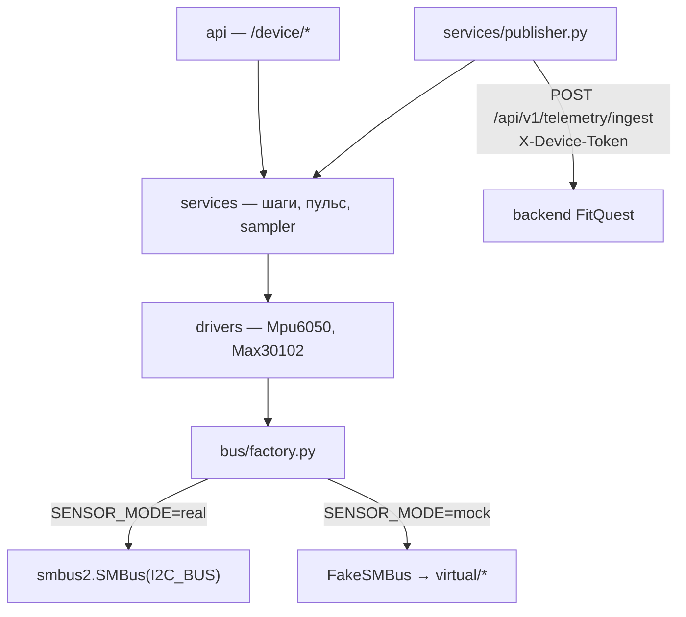

# FitQuest Raspberry Pi (`pi-fit-baddy`)

Узел датчиков FitQuest: Raspberry Pi с акселерометром **MPU6050** (шаги) и пульсометром **MAX30102** (пульс) на шине I2C. Сервис считает шаги и пульс, отдаёт их по локальному API `/device/*` и публикует в backend FitQuest как `TelemetryDTO` с `source=raspberry_pi`.

> **Статус: в разработке.** Код ещё не написан; этот README описывает целевое устройство модуля по требованиям [`docs/pi.md`](../docs/pi.md) и решениям D-08, D-17, D-18 ([`docs/planning/DECISIONS.md`](../docs/planning/DECISIONS.md)). Задачи — `docs/planning/issues/` (префикс `PI-`).
>
> Папка самодостаточна (свой `requirements.txt`, тесты, CI-job).

Главное правило: **код, проверенный на Mac/Linux в эмуляции, без изменений работает на плате.** При переезде меняются только переменные окружения.

## Как устроено

```
device/
  api/         FastAPI: /device/status, /device/vitals/current, /device/vitals/history, WS /device/stream
  bus/         factory.py (единственное ветвление по SENSOR_MODE), fake_smbus.py
  drivers/     mpu6050.py, max30102.py — работают с любой шиной, об эмуляции не знают
  services/    step_counter.py, heart_rate.py, sampler.py (фоновый опрос + кольцевая история), publisher.py (отправка в backend)
  virtual/     mpu6050.py, max30102.py (карты регистров), mock_bus.py, signals.py, scenarios.py, csv_player.py
  tools/       record.py — запись CSV с датчиков
  tests/
  clock.py     Clock, MonotonicClock, ManualClock
  config.py    все переменные окружения в одном месте
  timefmt.py   формат времени ISO-8601 UTC
```

Каталога `data/` в репозитории нет: записи с датчиков создаются командой из раздела «Запись CSV» (инструмент создаёт недостающие каталоги); крупные сырые записи (`data/*.raw`) исключены из git.



- Драйверы используют только `write_byte_data`, `read_byte_data`, `read_i2c_block_data` — эти методы есть и у `smbus2.SMBus`, и у `FakeSMBus`.
- `smbus2` и `gpiozero` импортируются лениво, только в ветке `real`; на Mac модуль импортируется без них.
- Время — через внедряемые часы `Clock.now()`; в тестах часы управляемые, `time.sleep` в тестируемой логике нет.
- Виртуальные чипы ведут себя как железо: спящий MPU6050 отдаёт нули, неверный адрес → `OSError(121, "Remote I/O error")`, невычитанный FIFO MAX30102 переполняется. Виртуальный MAX30102 пополняет FIFO одним отсчётом при каждом чтении `FIFO_WR_PTR`, а не по времени, поэтому в mock частота пульсовых отсчётов равна частоте опроса.

## Запуск без платы (mock)

```bash
cd pi-fit-baddy
python3.11 -m venv .venv && source .venv/bin/activate     # Windows: .venv\Scripts\activate
pip install -r requirements.txt                           # без smbus2 / gpiozero
SENSOR_MODE=mock GPIOZERO_PIN_FACTORY=mock pytest
SENSOR_MODE=mock uvicorn device.api.main:app --port 8080
curl http://localhost:8080/device/status                   # {"connected":true,"battery":82,"mode":"mock"}
curl http://localhost:8080/device/vitals/current           # heart_rate сначала null: окно пульса ещё копится
```

`SENSOR_MODE=mock` — значение по умолчанию. Источник данных выбирается переменной `SCENARIO`: `rest`, `walk` (по умолчанию), `run`, `recovery` либо префикс записанных CSV (см. «Запись CSV»). Встроенные сценарии зациклены: по окончании начинаются заново.

## Запуск на Raspberry Pi (real)

1. Raspberry Pi OS, Python 3.11+. Включить I2C: `sudo raspi-config` → Interface Options → I2C → Enable, перезагрузить.
2. Подключить датчики (схема ниже) и проверить адреса: `sudo apt install i2c-tools && i2cdetect -y 1` — должны появиться `68` и `57`.
3. Установить зависимости платы: `pip install -r requirements.txt -r requirements-pi.txt` (`smbus2`, `gpiozero`).
4. Создать файл с настройками (образец — `.env.example`), указав как минимум `SENSOR_MODE=real`.
5. Запустить: `uvicorn device.api.main:app --port 8080 --env-file .env`.

**Как читаются переменные.** Приложение читает только переменные окружения и файл `.env` само не загружает. Файл подхватывает `uvicorn` по флагу `--env-file` (ему нужен пакет `python-dotenv`, он устанавливается вместе с `uvicorn[standard]` из `requirements.txt`). Уже заданные в оболочке переменные имеют приоритет над значениями из файла. Без флага значения из `.env` игнорируются; вместо файла можно задавать переменные в окружении напрямую: `SENSOR_MODE=real uvicorn device.api.main:app --port 8080`.

**Адрес привязки.** Команда выше слушает `127.0.0.1` (адрес `uvicorn` по умолчанию): API доступен только с самой платы. Для отладки с другой машины в доверенной сети можно добавить `--host 0.0.0.0`, но у локального API нет аутентификации — любой в сети увидит пульс и шаги. Android обращается только к backend; публикатор работает внутри процесса и локальный API для этого не нужен.

### Схема подключения

Оба датчика — на шину I2C1 (`I2C_BUS=1`), параллельно.

| Сигнал | Raspberry Pi (физ. пин) | MPU6050 (GY-521) | MAX30102 |
|---|---|---|---|
| 3.3 V | 1 | VCC | VIN |
| GND | 6 | GND | GND |
| SDA (GPIO2) | 3 | SDA | SDA |
| SCL (GPIO3) | 5 | SCL | SCL |
| адрес | — | `0x68` (AD0 → GND) | `0x57` |
| прерывание (необязательно) | 11 (GPIO17, `MAX30102_INT_PIN`) | — | INT |

Питание и подтяжки зависят от конкретных плат-модулей — см. «Проверить на реальной плате». Вывод INT и `MAX30102_INT_PIN` текущим кодом не используются.

## Отправка данных в backend

Узел и телефон друг с другом не связываются: узел отправляет точки в backend, приложение читает их оттуда. Подключение — по коду сопряжения.

1. В Android-приложении: Live watch → «Источник данных» → «Подключить Raspberry Pi». Приложение покажет 6-значный код (действует 10 минут).
2. Запустить узел с этим кодом:

```
BACKEND_URL=http://192.168.1.10:8000
PUBLISH_ENABLED=true
PAIRING_CODE=123456
```

Узел обменяет код на свой токен (`POST /api/v1/devices/pair`), сохранит его в `DEVICE_TOKEN_FILE` (по умолчанию `.device_token.json`, права 600, в git не попадает) и начнёт публиковать. В приложении устройство появится в списке, точки пойдут в Live watch. Дальше узел запускается без `PAIRING_CODE` — токен берётся из файла. `DEVICE_ID` можно не задавать: по умолчанию `pi-<hostname>`.

Повторное сопряжение (новый код) выдаёт новый токен, старый перестаёт работать. Отвязка в приложении тоже отключает токен — узел получит 401 и напишет об этом в лог.

Без сопряжения можно задать `DEVICE_ID` и `DEVICE_TOKEN` вручную (токен из `POST /api/v1/devices/register`) — `DEVICE_TOKEN` из окружения всегда имеет приоритет.

Публикация выключена по умолчанию. Если `PUBLISH_ENABLED=true`, но `BACKEND_URL`, `DEVICE_ID` или `DEVICE_TOKEN` не заданы и их не дали ни сопряжение, ни сохранённый файл (или `BACKEND_URL` не вида `http(s)://host[:port]`, или `PUBLISH_INTERVAL_SECONDS` меньше 1), сервис не стартует и сообщает, чего не хватает.

**Что отправляется.** Раз в `PUBLISH_INTERVAL_SECONDS` (первая отправка — через один интервал после старта) публикатор снимает текущее показание и ставит его в очередь. Отправляется `POST <BACKEND_URL>/api/v1/telemetry/ingest` с заголовком `X-Device-Token` и телом `TelemetryDTO`:

```json
{"device_id": "pi-livingroom-01", "steps": 4213, "heart_rate": 76,
 "calories": 169, "timestamp": "2026-10-14T12:00:00Z", "source": "raspberry_pi"}
```

- `user_id` узел не знает: backend определяет пользователя по токену.
- `steps` — шаги, накопленные с запуска сервиса (то же число, что в `/device/vitals/current`), а не приращение за интервал. После перезапуска сервиса счётчик начинается с нуля.
- `calories = round(steps × CALORIES_PER_STEP)`.
- Точка **без валидного пульса пропускается** (не отправляется): `heart_rate` равен `null` или вне диапазона 30–230. Шаги при этом не теряются: следующая отправленная точка несёт полный итог.

**Повтор и отбрасывание** (очередь отправляется от старых точек к новым, первая неудача прерывает цикл):

| Результат запроса | Что происходит с точкой |
|---|---|
| 2xx | принята, удаляется из очереди |
| сеть недоступна, таймаут, 5xx, 408, 429 | остаётся в очереди, повтор на следующем цикле |
| 3xx | отбрасывается; в лог — подсказка проверить `BACKEND_URL` (возможно, нужен https) |
| 401, 403 | отбрасывается; в лог — проверить `DEVICE_ID` и `DEVICE_TOKEN` |
| прочие 4xx | отбрасывается |

Очередь в памяти ограничена **100 точками**; при переполнении вытесняется самая старая. Доставка «минимум один раз»: при потере ответа точка может уйти повторно, идемпотентности в контракте нет. После перезапуска сервиса несданные точки пропадают.

## Конфигурация

Переменные окружения читает `device/config.py`; пустое значение равносильно незаданному.

| Переменная | По умолчанию | Назначение |
|---|---|---|
| `SENSOR_MODE` | `mock` | `mock` — FakeSMBus и виртуальные чипы; `real` — `smbus2` |
| `I2C_BUS` | `1` | номер шины I2C |
| `MPU6050_ADDR` | `0x68` | адрес акселерометра (допустимы `0x69`, десятичная запись) |
| `MAX30102_ADDR` | `0x57` | адрес пульсометра |
| `MAX30102_INT_PIN` | `17` | GPIO прерывания (читается в конфиг, кодом пока не используется) |
| `GPIOZERO_PIN_FACTORY` | — | `mock` в тестах |
| `SAMPLE_RATE_HZ` | `50` | частота опроса датчиков, Гц |
| `STEP_THRESHOLD_G` | `0.15` | порог пика ускорения для шага, g |
| `STEP_MIN_INTERVAL_MS` | `300` | минимальный интервал между шагами, мс |
| `STEP_SMOOTHING_SAMPLES` | `3` | окно сглаживания ускорения, отсчётов |
| `HR_BAND_HZ_LOW` | `0.5` | нижняя граница полосы пульса, Гц |
| `HR_BAND_HZ_HIGH` | `4.0` | верхняя граница полосы пульса, Гц |
| `HR_WINDOW_S` | `5.0` | окно оценки пульса, с |
| `HR_MIN_SIGNAL_RATIO` | `0.01` | минимальное отношение амплитуды пульсовой компоненты `(макс−мин)/2` к постоянной составляющей ИК-сигнала; ниже — `heart_rate: null` |
| `HISTORY_MAX_POINTS` | `3600` | размер кольцевой истории (точка раз в секунду, то есть до часа) |
| `BATTERY_PERCENT` | `82` | заряд для `/device/status` (датчика заряда может не быть) |
| `SCENARIO` | `walk` | источник данных в mock: сценарий или префикс CSV |
| `BACKEND_URL` | — | адрес backend, `http(s)://host[:port]` |
| `DEVICE_ID` | `pi-<hostname>` при сопряжении | идентификатор устройства |
| `DEVICE_TOKEN` | — | токен устройства (секрет, не коммитить); если не задан — из сопряжения |
| `PAIRING_CODE` | — | 6-значный код из приложения; обменивается на токен при запуске |
| `DEVICE_TOKEN_FILE` | `.device_token.json` | куда сохраняется токен после сопряжения |
| `PUBLISH_ENABLED` | `false` | включить публикатор (`1`, `true`, `yes`, `on`) |
| `PUBLISH_INTERVAL_SECONDS` | `5` | интервал публикации, с (не меньше 1) |
| `CALORIES_PER_STEP` | `0.04` | оценка калорий по шагам |

Параметры алгоритмов (`SAMPLE_RATE_HZ`, `STEP_*`, `HR_*`) — стартовые значения, подобранные на синтетике; на железе их нужно подбирать заново.

**Не переменные окружения** (константы в коде): размер очереди публикатора — 100 точек (`BUFFER_MAX_POINTS`), таймаут HTTP-запроса — 5 с (`HTTP_TIMEOUT_S`), допустимый пульс для публикации — 30–230, интервал записи в историю — 1 с (`HISTORY_INTERVAL_S`).

## API узла (контракт [`docs/pi.md`](../docs/pi.md), не меняется)

```
GET /device/status                   → {"connected": true, "battery": 82, "mode": "mock"}
GET /device/vitals/current           → {"heart_rate": 76, "steps": 4213, "timestamp": "2026-10-14T12:00:00Z"}
GET /device/vitals/history?from=&to= → [{"heart_rate": 74, "steps": 4100, "timestamp": "..."}, ...]
WS  /device/stream                   → те же поля раз в секунду
```

- Время — ISO-8601 UTC.
- Если датчик не отвечает: `connected: false`, сервис не падает.
- `heart_rate: null` означает, что оценки нет: сигнал слабый или шумный, окно пульса ещё не накоплено либо пульсометр не отвечает. Число не выдумывается.
- История пишется раз в секунду и хранится в памяти (кольцевой буфер `HISTORY_MAX_POINTS`); после перезапуска она пуста. Параметры `from` и `to` необязательны, границы включаются.
- Android к этому API не обращается — только к backend.

## Запись CSV с реальных датчиков

Инструмент `device/tools/record.py` опрашивает датчики теми же драйверами и той же шиной, что и сервис, с частотой `SAMPLE_RATE_HZ`, и пишет два файла:

| Файл | Заголовок | Содержимое |
|---|---|---|
| `<PREFIX>_accel.csv` | `t,x,y,z` | ускорение по осям, g |
| `<PREFIX>_ppg.csv` | `t,ir,red` | сырые отсчёты MAX30102: ИК и красный канал |

`t` — секунды от начала записи. Порядок колонок PPG — `ir,red`, хотя драйвер отдаёт пары `(red, ir)`. Если за один опрос в FIFO накопилось несколько отсчётов, их метки времени равномерно сдвигаются назад от момента опроса с шагом `1 / SAMPLE_RATE_HZ` и не убывают.

```bash
# остановите сервис: он и запись читают один FIFO MAX30102
SENSOR_MODE=real python -m device.tools.record --seconds 120 --out data/walk_2026-10-14
# → data/walk_2026-10-14_accel.csv и data/walk_2026-10-14_ppg.csv
```

| Флаг | Назначение |
|---|---|
| `--seconds N` | длительность записи, с (больше 0) |
| `--out PREFIX` | префикс файлов; недостающие каталоги создаются |
| `--force` | перезаписать существующие файлы (без флага они не трогаются) |

Коды возврата: `0` — готово; `1` — ошибка шины или датчика либо невозможность записать файлы (уже записанные строки сохраняются); `2` — неверные аргументы (в том числе пустой `--out` или `--out` с `/` на конце) или файлы уже существуют; `130` — прерывание по Ctrl+C (записанные строки сохраняются). В конце печатаются число строк, пути файлов, длительность и фактическая частота. Предупреждения:

- запись шла с отставанием от расписания (фактическая частота ниже 95 % от `SAMPLE_RATE_HZ`): проигрыватель CSV игнорирует колонку `t` и воспроизведёт такую запись с неверной скоростью;
- FIFO переполнялся (`OVF_COUNTER` > 0): в `ppg` возможны пропуски.

Объём: около 6 КБ/с (≈ 21 МБ в час при 50 Гц), следите за свободным местом на карте. Перед записью остановите сервис (оба читают один FIFO) и начинайте запись вскоре после подачи питания на датчик: пока FIFO никто не читает, чип продолжает его заполнять, и первые строки `ppg` могут оказаться устаревшими. Инструмент этого заметить не может: при ровно 32 непрочитанных отсчётах `available_samples()` не отличает полный FIFO от пустого; очистка FIFO требует подтверждённого по даташиту поведения указателей, это проверяется на плате. Без платы `SENSOR_MODE=mock python -m device.tools.record ...` пишет синтетику выбранного сценария — так можно проверить формат.

Прогнать алгоритмы на записи (зациклена, колонка `t` игнорируется, частота определяется опросом сервиса):

```bash
SENSOR_MODE=mock SCENARIO=data/walk_2026-10-14 uvicorn device.api.main:app --port 8080
curl http://localhost:8080/device/vitals/current
```

## Сверка с симулятором Wokwi

Драйвер MPU6050 без изменений запускается на Pi Pico в [Wokwi](https://wokwi.com) против независимой модели датчика, а поток оттуда считается нашим алгоритмом шагов — инструкция в [`wokwi/README.md`](wokwi/README.md). MAX30102 в Wokwi нет.

## Значения из даташитов

Не придумываются: подтверждённое имеет источник, неподтверждённое помечено в коде `TODO(datasheet)`.

### Источники и степень проверки

Ни один PDF-даташит при подготовке этого узла не открывался целиком; ниже указано, что откуда взято и что реально проверено.

- **MPU6050** — [регистровая карта InvenSense MPU-6000/6050](https://www.invensense.com/wp-content/uploads/2015/02/MPU-6000-Register-Map1.pdf). Значения (таблица LSB/g по `AFS_SEL`: 16384 / 8192 / 4096 / 2048 для ±2 / ±4 / ±8 / ±16 g; `PWR_MGMT_1` после сброса `0x40`; `WHO_AM_I` = `0x68`; адреса регистров) сверены по ссылкам на эту регистровую карту и независимо с драйвером `inv_mpu6050` из ядра Linux. Сам PDF не открывался.
- **MAX30102** — [даташит](https://wcm-cce.cldnet.analog.com/media/en/technical-documentation/data-sheets/MAX30102.pdf). Ссылка получена из поисковой выдачи и не открывалась; таблица `SPO2_SR` из него восстановлена лишь частично (7 кодов из 8). `PART_ID` = `0x15` и глубина FIFO 32 взяты из нескольких открытых драйверов, а не из PDF. Откройте даташит вручную и сверьте.
- **`smbus2`** — [исходники](https://github.com/kplindegaard/smbus2). Ограничение блочного чтения `read_i2c_block_data` в 32 байта проверено по коду библиотеки (поэтому драйвер читает FIFO по 5 отсчётов).
- **Шаги** — [статья о педометре на 3-осевом акселерометре](https://www.analog.com/en/resources/analog-dialogue/articles/pedometer-design-3-axis-digital-acceler.html). Обосновывает общий подход: модуль вектора ускорения, сглаживание, пик с порогом и минимальным интервалом. Конкретные значения (`STEP_*`) статьёй не подтверждены.
- **Пульс** — [City, University of London](https://openaccess.city.ac.uk/11712) и [arXiv 2412.17538](https://arxiv.org/pdf/2412.17538). Обосновывают подход: разложение на AC/DC, полосовой фильтр, поиск пиков, проверка согласованности межударных интервалов. Конкретные значения (полоса 0.5–4 Гц, окно 5 с, пороги) этими работами не подтверждены: это предварительные стартовые значения, подобранные на синтетике.

### Не подтверждено (`TODO(datasheet)`)

Перечень сверен с `grep -rn "TODO(datasheet)" device --include="*.py"`. Этот `grep` находит также два комментария в `device/virtual/scenarios.py` и `device/virtual/signals.py`, где сказано лишь, что маркер не нужен, — это не открытые пункты.

- Порядок каналов в отсчёте FIFO MAX30102 (сейчас RED, затем IR; 3 байта на канал, 18 бит значимых) — в `device/drivers/max30102.py` и `device/virtual/max30102.py`.
- Значение `MODE_CONFIG` после включения питания (бит `SHDN`): виртуальный чип стартует с `0x00` — `device/virtual/max30102.py`.
- `Max30102.initialize()` только сбрасывает `SHDN`. Не выставляются и не проверены: биты режима `MODE[2:0]`, `SPO2_CONFIG`, `FIFO_CONFIG`, токи светодиодов `LED1_PA` и `LED2_PA` — `device/drivers/max30102.py`.

Без пометки `TODO(datasheet)` в коде, но тоже не подтверждено и проверяется на плате:

- полная таблица частот `SPO2_SR` в `SPO2_CONFIG` (в частности код `100`); код ни читает, ни задаёт `SPO2_CONFIG`;
- `INT_STATUS` и `INT_ENABLE` не используются (виртуальный чип читает их как 0);
- условие сброса `OVF_COUNTER` — собственное решение: виртуальный чип считает до 15 без оборота и сбрасывает счётчик только записью в регистр; поведение реального чипа не сверено.

## Проверить на реальной плате

**Проверка на реальной плате ещё не выполнена.** Эмуляция этого не покажет — проверяется вручную при первом подключении. Результаты заносятся в таблицу ниже.

- Адреса на шине (`i2cdetect -y 1`); у MPU6050 адрес меняется пином AD0 (`0x68` / `0x69`).
- `PART_ID` MAX30102 (ожидается `0x15`, значение взято из открытых реализаций, не из даташита) и `WHO_AM_I` MPU6050 (`0x68`).
- Питание модулей: на каких платах есть свои стабилизаторы и подтяжки SDA/SCL, не конфликтуют ли подтяжки двух модулей.
- Скорость шины I2C (100/400 кГц) и стабильность чтения FIFO на ней.
- Настройка MAX30102: режим, частота выборки, усреднение, токи светодиодов (`LED1_PA`, `LED2_PA`) — их сейчас не выставляет `initialize()`. Согласовать частоту отсчётов чипа с `SAMPLE_RATE_HZ`: если чип накапливает за один опрос больше одного отсчёта, `HeartRateEstimator` лишние пропускает.
- Порядок каналов RED/IR в FIFO: при ошибке пульс считается по красному каналу.
- Запись CSV: сервис остановлен (оба читают один FIFO), запись начата вскоре после подачи питания на датчик; первые строки `ppg` могут быть устаревшими, так как чип заполняет FIFO, пока его не читают, а при ровно 32 непрочитанных отсчётах полный FIFO не отличить от пустого. Очистку FIFO проверить на плате по даташиту.
- Длительность одного тика опроса с реальной шиной и не тормозит ли блокирующее I2C цикл событий (API, публикатор).
- Переполнение FIFO (`OVF_COUNTER`) при реальной частоте опроса.
- Шаги: уровень шумов акселерометра в покое и при ходьбе — подобрать `STEP_THRESHOLD_G`, `STEP_MIN_INTERVAL_MS`, `STEP_SMOOTHING_SAMPLES`.
- Пульс: амплитуда ИК-сигнала, полоса фильтра (`HR_BAND_HZ_LOW`/`HR_BAND_HZ_HIGH`), окно `HR_WINDOW_S`, порог `HR_MIN_SIGNAL_RATIO` («слабый сигнал → `null`»), доля пика, число пиков и регулярность интервалов.
- Артефакты движения и длинная пауза между отсчётами (сбой шины, остановка сервиса): как ведёт себя оценка пульса.
- Точность шагов и пульса против эталона (счётчик шагов телефона, пульсометр).
- Ручной сценарий публикации «точка видна в Android»: в приложении «Подключить Raspberry Pi» → запустить узел с `PAIRING_CODE`, `BACKEND_URL`, `PUBLISH_ENABLED=true` → устройство появилось в списке, точка с источником «Raspberry Pi» видна в Live watch.
- Согласовать с автором приёма на backend смысл `steps` (накопленные с запуска сервиса) и то, что точки без пульса не отправляются.

### Результаты проверки на плате

| Параметр | Ожидалось | Измерено | Дата |
|---|---|---|---|
| | | | |

## Тесты

`SENSOR_MODE=mock GPIOZERO_PIN_FACTORY=mock pytest` — без платы и без `smbus2`/`RPi.GPIO`. Качество кода: `ruff check .`. Тесты покрывают:

- MPU6050: `WHO_AM_I`; без пробуждения данных нет; смена диапазона меняет масштаб; неверный адрес → ошибка;
- MAX30102: инициализация; разбор байтов FIFO; переполнение увеличивает `OVF_COUNTER`;
- шаги: «ходьба N шагов» → N ± допуск, покой → 0; пульс: сценарий 72 уд/мин → 72 ± 3, слабый сигнал → `null`;
- sampler, публикатор (коды ответов, очередь, повторы), API по контракту в mock;
- проигрыватель CSV и инструмент записи (формат, порядок каналов, круг «запись → шаги и пульс», защита от перезаписи, сбой шины);
- переносимость: драйверы работают с подменённой шиной того же интерфейса.

## Владельцы

@MouseViolin (модуль 5, устройства).
